# XOXO Studio

A portable studio on a Raspberry Pi with a 3.5" touchscreen, by XOXO Audio Labs. It's the FM-1 Companion Studio with the FM-1 taken out, so it works as a universal tool with any USB or Bluetooth MIDI gear and any USB sound source.

**Status: installs and starts on a Pi; most of it not yet tried on hardware.** The FM-1 parts are out: the SLOOP and X0X apps, the FM-1 library (backups, projects, sample slots, firmware), and FM-1 A/B in the sound sources and MIDI routes. What's been tried and what hasn't is under [Tested](#tested).

## Hardware

**The parts, their cost (about $129–144 from PiShop.us) and how they go together: [docs/BUILD.md](docs/BUILD.md).** In short:

- **Raspberry Pi 4** (1 GB is enough), the planned build: its USB-C port makes the Studio a USB audio + MIDI interface for a computer. A Raspberry Pi 3 B+ runs everything else (the Studio so far has run on one)
- A 3.5" SPI touchscreen on the pins (ILI9486 display, XPT2046 touch): the Hosyond / Waveshare (A) "3.5 inch RPi LCD" (tested), or the Waveshare (C) (not yet tried). Or the UCTRONICS 3.5" HDMI touchscreen: the picture on HDMI, its touch on the pins (tested on a Pi 3 B)
- A microSD card (16 GB or more)
- A Bluetooth speaker or headphones, or a wired one (the DAC HAT's outs, or the Pi's 3.5 mm jack)
- Optional: the InnoMaker HiFi DAC HAT (headphones and RCA line out), USB MIDI keyboards and controllers, USB audio (a keyboard's own sound, an audio interface), a Hercules DJControl Inpulse 200 MK2 for the DJ decks, a PiSugar 3 Plus battery

## Set up

1. **Flash the card** with Raspberry Pi Imager: your Pi (*Raspberry Pi 4*, or *3*), *Raspberry Pi OS Lite*. In its settings, set the hostname `XOXOStudio`, a user name and password, your Wi-Fi, and **enable SSH**.
2. **Boot the Pi** (give it a few minutes the first time).
3. **Get the app onto the Pi**, either way:
   - **From a download:** on GitHub, *Code › Download ZIP*, unzip it, and from the unzipped `XOXO-Studio-main` folder:
     ```
     scp -r fm1-bt-bridge YOUR_USER@xoxostudio.local:~
     ```
   - **With git** (updates later are a `git pull`): the repository is private, so give the Pi a deploy key, an SSH key that opens this repository only, read-only. On the Pi (`ssh YOUR_USER@xoxostudio.local`):
     ```
     sudo apt-get update && sudo apt-get install -y git
     ssh-keygen -t ed25519 -N "" -f ~/.ssh/id_ed25519 -C "xoxostudio"
     cat ~/.ssh/id_ed25519.pub
     ```
     On GitHub: the repository's **Settings › Deploy keys › Add deploy key**, paste that line, leave *Allow write access* off. Then `git clone git@github.com:xoxoaudiolabs/XOXO-Studio.git` (answer `yes` to GitHub's host key) and use `XOXO-Studio/fm1-bt-bridge` below.
4. **Install** over SSH, then reboot (it asks for your password once):
   ```
   ssh YOUR_USER@xoxostudio.local
   bash fm1-bt-bridge/install.sh
   sudo reboot
   ```
   Options, for the parts you have (e.g. `bash fm1-bt-bridge/install.sh --dac --screen c`):
   - `--dac`: the InnoMaker HiFi DAC HAT (it adds the DAC's driver to `config.txt`). The DAC is then the Studio's master out: its headphone (aux) and RCA outs both carry the main mix, MASTER in the mixer sets its level, and the Pi's own 3.5 mm jack stays PHONES (CUE and the click). A Bluetooth speaker gets a copy of the master.
   - `--screen c`: the Waveshare 3.5" (C). Without it, the Hosyond / Waveshare (A).
   - `--screen hdmi`: the 3.5" HDMI touchscreen (UCTRONICS): HDMI sent 720x480, which the screen scales to its panel, and its touch on SPI CE0 with its interrupt on GPIO 25. An SPI screen's overlay from before is switched off (it holds the same pins).
   - On a Pi 4 the installer also sets up the USB interface (its USB-C port), with nothing to choose.
   On the first start the Studio asks for the touch setup (four targets) before HOME.

**Updating with git:** on the Pi, `cd XOXO-Studio && git pull && bash fm1-bt-bridge/install.sh`, then `sudo reboot`.

The web page is at `http://xoxostudio.local`. It's the same web app as the FM-1 Companions' (Studio and Pocket): it shows what each box has. Served from this box it's named XOXO Studio, with its own home-screen app id, so a phone can keep it beside a Companion's.

The web page's tabs: **Status** (speaker, volume, the mixer with DECKS while they play, a linked Pocket, clock, keyboard, Record), **Studio** (XO-4's patterns A–H, Play / Stop, MIDI IN and the synths' starting sounds; the pads' kits; what's on each DJ deck; the Studio DJ Music folder, where tracks can be added from a phone), **MIDI** (the routes and presets), **Library** (samples), **Editor** and **Recordings**.

## What's inside

- **HOME:** the tempo with − / +; every source (each USB device, the pads, XO-4, the decks while they run) and the speaker, each with a small bar and a % for its mixer level (beside a source's name: USB, its input pair, or a plug-in's words for it, such as an FM-1's firmware with the FM-1 Companion plug-in); REC, START, TAP
- **MIXER, RECORD:** every source a level, with M (mute) and S (solo) above its fader (also on the web page; HOME says MUTE or OFF), recorded as one mix (or a part each), with meters. Mute and solo leave CUE and Record parts as they are, and a restart clears them
- **EDITOR:** the sample editor (full screen): a recording or a sample trimmed, faded, its note found, saved as a new sample, or put straight on a pad (TO PAD)
- **XO-4:** the Studio's own groovebox, with the 16-pad sampler in its DRUMS (full screen; below); the 808 KIT is loaded on the first start
- **DECKS:** two DJ decks (full screen), from the Studio DJ Music folder or a USB drive, played by touch, a Hercules DJControl Inpulse 200 MK2, or any controller after MIDI LEARN; each deck its own FX (ECHO on the beat, REVERB, FLANGER, BRAKE: FX tapped on or off, held for the next one; echo and reverb ring out)
- **MIDI:** routes between Bluetooth MIDI, each USB MIDI device, network MIDI (a DAW) and the pads, with channels, transpose, velocity, chord memory and an arpeggiator per route
- **The Pocket by Ethernet:** an FM-1 Companion Pocket on a cable straight to the Studio (no router needed: both take a link-local address) joins the Studio's network MIDI as NET. MIDI goes both ways, and the Studio's clock leads: its clock to NET (Box>NET) is on from the start. The Pocket's sound comes over the link too (RTP on UDP 46000) and shows as POCKET in HOME, the mixer and recordings while the Pocket is linked; the Studio keeps the Bluetooth speaker, and the Pocket lets go of its own. A Pocket that splits its FM-1s (up to three) sends each on a stream of its own (UDP 46002, 46004, 46006) and a network MIDI session of its own: each FM-1 plugged into it is then a mixer channel and a device in the routes, POCKET FM-1 A-C (FM-1 E-G with the FM-1 Companion plug-in), and POCKET leaves the mixer
- **The link as a snake:** the Studio's master goes back to a linked Pocket over the same cable (RTP on UDP 46010, the Pocket's own format), for headphones at the Pocket: MORE > AUDIO > **Mix to Pocket**, on at first: linked, sound and MIDI go both ways. MORE > AUDIO > **Pocket sends** is what comes from the Pocket: **MIX** (its own gear mixed, one stream, POCKET in the mixer; at first, as a Zero W Pocket keeps up with that and the return), **FM-1s** (each of its FM-1s a channel of its own: four streams, too much for a Zero W with the return on) or **MIDI ONLY**. The Pocket reads both in the Studio's `/api/status` (`link_audio`, `link_return`) and follows. MORE > AUDIO > **Latency** lowers the Studio's audio block and the link's receive buffer together: SAFE (1024 samples, 44 ms buffer), LOW (512, 24 ms), LOWER (256, 18 ms), LOWEST (128, 15 ms): the buffer holds one of the Pocket's blocks (it goes no lower than 512) and one of the Studio's. The lowest a Pi 3 plays without clicks is to be found by ear
- **Linked REC:** linked to a Pocket, REC on either box starts a take on both, and STOP stops both (MIDI Machine Control Record and Stop over the link, to and from the Pocket's own network MIDI session). Each box records its own gear: with **Record parts** on, a file a source, so one take is every track of both boxes. A linked take has a note beside it (`<take>.wav.link.json`): how long after its REC its first sample landed (`first_sample_after_trigger_ms`; the two boxes' RECs are the cable's ~1 ms apart), to line the two boxes' files up by. MORE > AUDIO > **Linked REC**, on at first. (The Pocket has to answer MMC and send it: work on the Pocket's side.)
- **Two Studios linked (Follow Studio):** MORE > AUDIO > **Follow Studio** on one Studio links it to another on the network or a cable, as a Pocket links: the other one leads. The one following takes its clock (tempo, Start and Stop) and passes it to its own gear along its **Box** routes, as its own clock would go (an FM-1 on Box> follows the leader; not where its NET route to the same device is on, so never twice), sends its notes back (never clock), and its master goes to the leader over the link (RTP on UDP 46020), where it's a mixer channel, STUDIO, beside a Pocket's POCKET. Linked REC works between them. The one following takes the leader's **Latency** step too (it reads it every 10 s), so both work in the same block, and the leader's STUDIO buffer is sized for a Studio, not a Pocket: whole packets of 6.458 ms (PipeWire's receiver asks for that), 2 at LOWER and LOWEST (12.92 ms), 4 at LOW, 7 at SAFE. A Studio never follows itself or a Studio that's following another, and while it follows, it turns a Pocket's link away (network MIDI's NO), so the Pocket links to the leader
- **The link in the journal:** each network MIDI peer linking, linking again, leaving (BY) or forgotten after going quiet is a line in the system journal (`journalctl | grep "network MIDI"`). A Pocket or a Studio following is forgotten after 25 s without a sync, a computer after 90 s
- **USB out:** with no DAC HAT, a USB audio interface's output gets a copy of the master (beside the Pi's jack or a Bluetooth speaker, or as the master when there's neither). MORE > AUDIO > **USB out**, shown while one is plugged in: AUTO (the first whose card has no MIDI, so an interface rather than a synth; an FM-1 has no output at all), one picked by name, or OFF. MASTER in the mixer sets its level (as a DAC HAT's)
- **MORE:** settings, themes, Wi-Fi, touch setup, shut down

EDITOR, XO-4, DECKS and RECORD are full screen: "< HOME", top left, leads back. MIXER, MIDI and MORE keep the tab bar and have "< HOME" too.

### XO-4

The Studio's own groovebox, being built (`fm1-bt-bridge/xo4.py`, `xo4synth.py`, `deskxo4.py`):

- **Four tracks on the box's beat grid:**
  - **DRUMS** is the 16-pad sampler (notes 36–51 play it from the MIDI routes, as SMP): each hit with its level (NORM, GHOST, SOFT, HARD) and ratchet (X1–X4).
  - **SYN 1** and **SYN 2** are two-operator FM synths, with chords of up to four notes.
  - **MIDI** goes out through the routes, as the source XO4.
- **Patterns:** A–H, changing on the next bar. Each track has its own length, up to 64 steps.
- **Sound:** a source of its own, XO-4, in the mixer, the meters and recordings.
- **The XO-4 tab:**
  - **Header:** < HOME, the patterns A–H, REC (live: pads played go onto DRUMS while it plays) and PLAY / STOP.
  - **Track row:** the track, its length LEN − / +, and HOLD CLR.
  - **Steps:** 16 a page.
  - **Step row:** the pages, then the selected step's VEL and LEN.
  - **DRUMS:**
    - **The pads:** played (they sound while held, playing or not) and picked for the steps: the steps put the picked pad on or off.
    - **The hit just put on:** its LEVEL, ratchet and the step's NUDGE − / +. QUANT: live REC on the grid, or where it was played.
    - **KIT:** the kits (load, save, new). **RPT:** note repeat. **FX:** the sixteen punch-in FX (on the pads' sound). **PADS:** the 16 pads big, 4×4, full screen, with KIT, RPT, FX, REC and EDIT above them. **MIDI IN:** off at first, so a synth or the Pocket on the MIDI routes plays only itself; on, the routes' SMP column plays the pads (and live REC records them). Clock and start/stop still reach the pads either way. **EDIT:** a tap opens the pad's page (its sample, level, pan, tune, mode, choke; sampling into it, trimming it).
  - **SYN 1, SYN 2, MIDI:**
    - **The note keys:** OCT, KEY, SCALE, and 14 keys, which offer only the scale's notes.
    - **FX:** XO-4's own sixteen punch-in FX on the two synths' sound (hold one, or LATCH it), apart from the pads' FX.
    - **Placing a step:** tap an empty step to place the last notes and select it. Keys add notes to it or take them off, four at most.
    - **Emptying a step:** tap the selected step again.
  - **SOUND** (SYN 1, SYN 2): the synth's page. Six starting sounds (KEYS, BASS, BELL, PLUCK, PAD, LEAD) and its
    settings, each − / + (held: four steps): RATIO, BRIGHT, BR DECAY, BR HOLD (how the brightness falls, and what
    stays), ATTACK, DECAY, SUSTAIN, RELEASE, LEVEL. HEAR plays the track's last notes; while stopped, a change does.
  - **Hearing it:** while stopped, what you tap sounds.

The SAMPLER tab and its own step sequencer are gone: a kit's pattern from it moves into the drums of XO-4's first pattern with empty drums, the first time that kit is used.

What XO-4 can't do yet is under [Known limitations](#known-limitations).

## Screens

Drawn on a PC by the Studio's own drawing code with a made-up studio (`python tools/studio_screens.py docs/images`), at twice the screen's 480×320: not photos of the device.

| | |
|---|---|
| 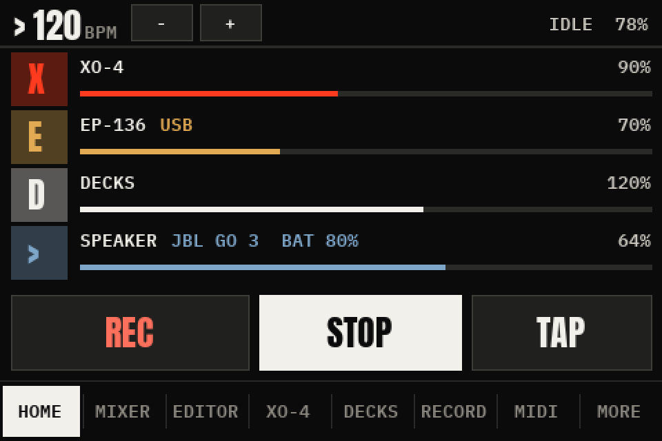 **HOME** | 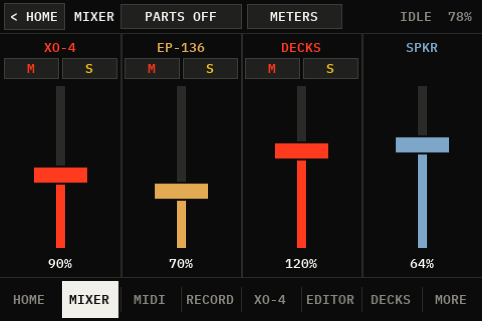 **MIXER** |
| 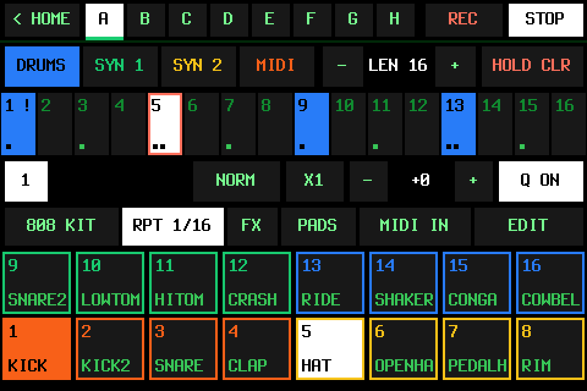 **XO-4: DRUMS** | 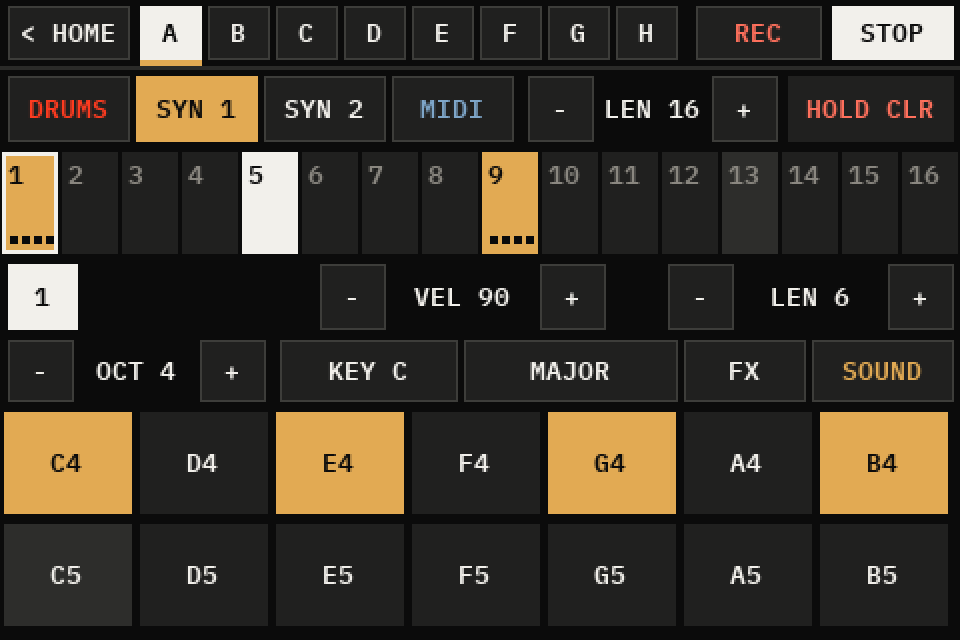 **XO-4: SYN 1** |
| 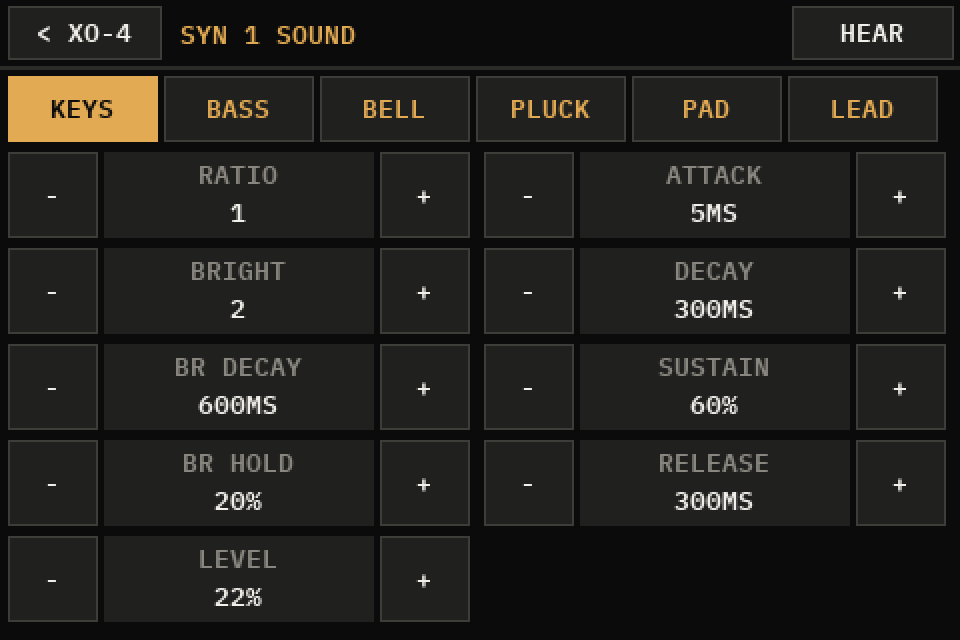 **XO-4: SOUND** | 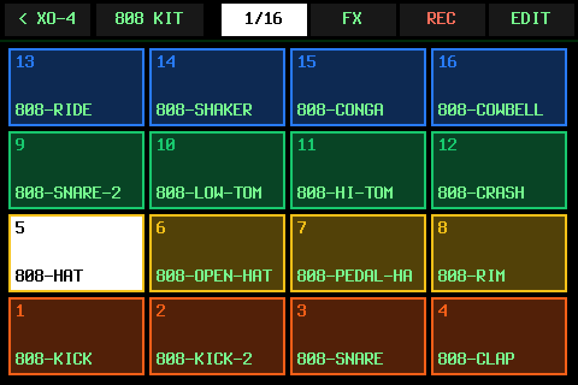 **XO-4: PADS** |
| 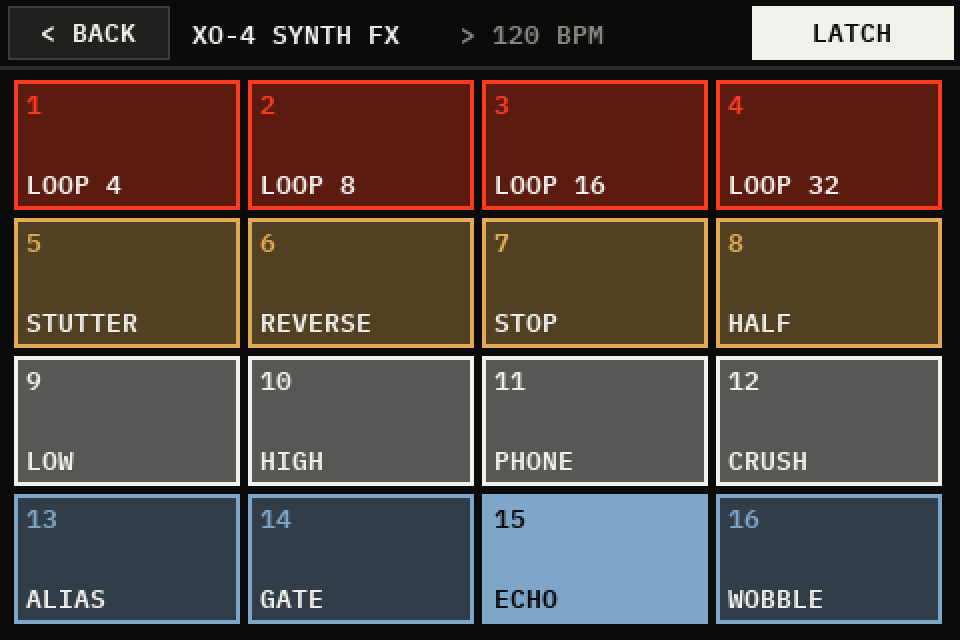 **XO-4: synth FX** | 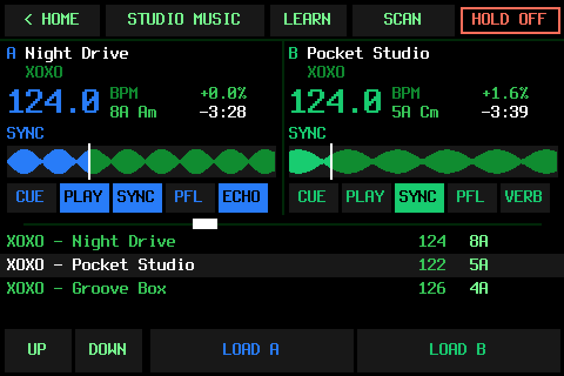 **DECKS** |
| 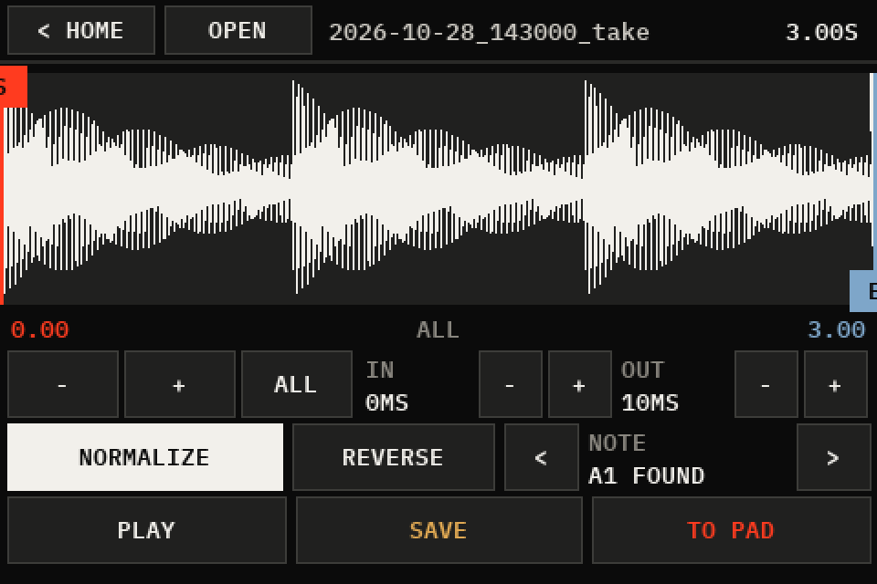 **EDITOR** | 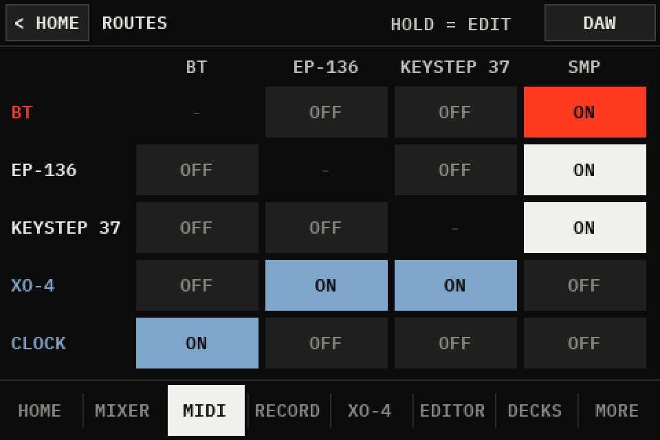 **MIDI** |
| 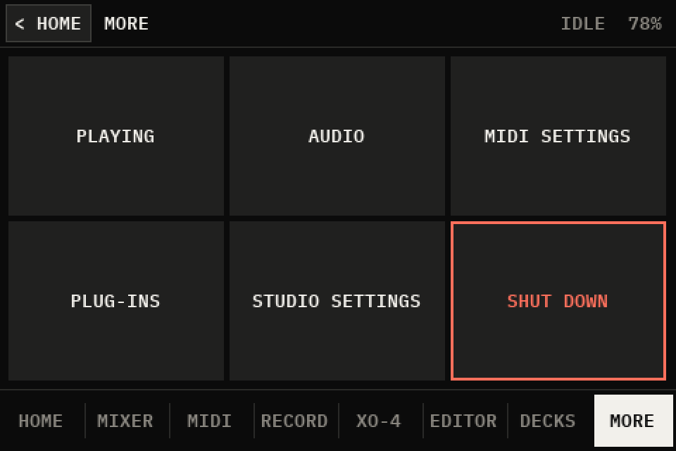 **MORE** | |

## Known limitations

- **The Pi 4 build isn't tried yet** (its parts arrive in November 2026): the Studio as a computer's USB audio + MIDI interface, the Waveshare (C) screen, the DAC HAT, the passive case. All of it is written and tested on a PC only.
- **Mostly untried on hardware.** Much of the Studio has only run on a PC so far: see [Tested](#tested) for what has and hasn't been tried on a Pi.
- **One hardware setup.** Made for a Raspberry Pi 3 B+ with a 3.5" 480×320 touchscreen (ILI9486 / XPT2046), and run on a Pi 3 B with the 3.5" HDMI touchscreen. Other Pis and other screens haven't been tried, and the screens are drawn for 480×320 only.
- **USB out:** only with no DAC HAT (with one, the DAC is the master out and a USB interface gets nothing).
- **Two Studios linked: the pads are the slow part.** A pad's sound passes a 1024-frame pipe, a block written ahead and a 10 ms player (about 40-50 ms) before the Studio's mixer, so a pad played across the link takes most of its round trip there (XO-4's synths the same). The link's own part isn't measured on its own yet.
- **CPU.** Each part was measured on its own on a Pi 3 B+: XO-4 about 30% of one core while it plays, the pads about 20%, the decks 28% (up to 49% with REVERB on both decks). Everything running at once hasn't been measured.
- **XO-4:**
  - Patterns can't be copied yet.
  - The synths can't be played live from a keyboard yet: XO-4 isn't a MIDI destination in the routes.
  - Eight patterns (A–H), up to 64 steps a track, four notes a step; a pattern change waits for the next bar.
- **DJ decks:** one FX at a time a deck. The Hercules DJControl Inpulse 200 MK2 has its own mapping; other controllers go through MIDI LEARN, which hasn't been tried with real hardware.
- **Speaker battery:** shown only when the speaker reports its battery to the Pi's Bluetooth (BlueZ). Many speakers don't, and then nothing shows.
- **Web page:** plain HTTP on the local network (`http://xoxostudio.local`), no password.
- **Private repository:** installing with git needs a deploy key (see [Set up](#set-up)).
- **Old names inside:** some names in the code still say fm1 (the `fm1-bt-bridge` folder, `~/fm1-library`, the service names). They're internal, and they're left as they are for now.

## Tested

**On hardware** (2026-10-28: a Raspberry Pi 3 B+ on Raspberry Pi OS Lite, Trixie, 64-bit; a 3.5" ILI9486 / ADS7846 touchscreen; a PiSugar battery):
- installed from the GitHub ZIP as above: the installer ran to the end with no errors in its log
- after the reboot the app, its sampler and the web page start; the screen and the touch are found; the settings hold a touch calibration and a theme picked on the screen
- the battery's charge is read, with a green bolt beside its percent while it charges that goes when the charger is unplugged (2026-11-01, the user's report)
- the web page loads from a PC at `xoxostudio.local`, as XOXO Studio, with its own manifest and icon
- the tab bar with DECKS on it looks right on the Studio's screen
- XO-4's FM synth: 8 voices (two tracks' 4-note chords) take 22% of one core, measured with the app running; it writes its demo WAV there (the demo not yet listened to)
- XO-4's engine, with a demo pattern put in by hand and the box clock started from the web page: the XO-4 source and the pads (the 808 KIT, played by XO-4's drum track) both carry sound, measured by recording each source on the Pi (peaks 0.66 and 0.81); XO-4 takes about 30% of one core while it plays, the pads about 20%
- the XO-4 tab, used by hand on the Studio's screen: works well (the user's report, 2026-10-28)
- "< HOME" at the top left of MIXER, SAMPLER, RECORD, MIDI and MORE looks right on the Studio's screen (the user's report)
- SAMPLER and RECORD full screen (no tab bar) look right on the Studio's screen (the user's report)
- HOME's tempo - / + beside the BPM work well on the Studio's screen (the user's report)
- HOME listing every source with its mixer level looks right on the Studio's screen (the user's report; the decks' row not yet seen with the decks playing there)
- the FX (the pads' punch-in FX, XO-4's synth FX, the decks' ECHO, REVERB, FLANGER, BRAKE) sound good on the Studio (the user's report, 2026-10-28)
- XO-4's MIDI IN: starts off on the Studio, the app runs with it (its effect on notes tested on the PC only)
- the web page's Studio tab (2026-10-29): it loads from the Studio and shows XO-4, the kits and the decks; XO-4's pattern changed from the page and back (checked in the page's status). Not yet tried from a phone: MIDI IN, the sounds, loading a kit, adding music, the decks' rows while they play, the DECKS level
- the Pocket's sound over the link (2026-10-29, over Wi-Fi): the Studio makes POCKET its own mixer channel while the Pocket is linked, an FM-1 on the Pocket plays out of the Studio's speaker, and it comes back after the Pocket's sender restarts (the user's reports). Not yet tried: the speaker handover, the latency by ear
- the Pocket on a direct Ethernet cable (2026-10-29): the Studio's eth0 takes 169.254.115.88 and keeps it past NetworkManager's DHCP timeout, the Pocket finds the Studio there by DNS-SD and links over it, and the Pocket answers a ping over the cable in about 1.5 ms. The Pocket's sound over the cable: "seems good now" (the user's report, after the Pocket's bridge restarted; before that it sent only silence, which the Pocket session traces to the FM-1's input needing to be opened afresh). Not yet tried after a reboot
- the Pocket link's Studio side, with a stand-in Pocket on a PC over Wi-Fi: it joins the Studio's network MIDI as "FM-1 Companion Pocket" and gets the Studio's clock (2026-10-29); the Studio's Ethernet setting is loaded by NetworkManager with no error
- the DJ decks played by touch alone (no controller), music from a USB drive, out of a JBL Go 3 over Bluetooth (the user's report, 2026-10-28, after the fix for their volume starting at 0)
- the InnoMaker HiFi DAC HAT on the Pi 3 B+ (2026-11-01): `install.sh --dac` adds its driver, the Pi lists it as BossDAC, the Studio makes it the master out (every mixer channel linked to it, the Pi's jack a copy) and both its headphone (aux) and RCA outs play (the user's report). Not yet tried: CUE on the Pi's jack beside it, a Bluetooth speaker's copy
- two Studios linked (2026-11-01: a Pi 3 B+ with the DAC HAT leading, a Pi 3 B with the 3.5" HDMI touchscreen following, on an Ethernet cable and over Wi-Fi): Follow Studio links them (the leader's journal: "XOXO Studio Link on FM-1CompanionStudio linked from 169.254.40.59"), the follower takes the leader's tempo (100 BPM), Stop and Start from the leader's web page stop and start both, REC and STOP from it start and stop a take on both, and the follower's master arrives on the leader's STUDIO channel (a stream, measured on the Pi; only silence so far: nothing made sound on the follower). Not yet tried: sound heard across, REC started on the follower, a Pocket and a Studio linked at once
- the leader's clock out a following Studio's Box routes (2026-11-01): with Box>U:Felucca on, the follower sent its FM-1 clock at the leader's 100 BPM (122 bytes in 3 s, counted by the kernel), none with the route off and again with it on, switched from the web page; the FM-1 followed (the user's report)
- USB out (2026-11-01, the Pi 3 B with no DAC HAT, a PCM2902 "USB Audio CODEC" interface and an FM-1 plugged in): AUTO picked the interface, not the FM-1, and a test tone played into the master came out of the interface's output (measured at its output, on the Pi). Not yet heard by ear
- the latency between two Studios (2026-11-01, Tester Tools 0.2 on the leader: a note out over network MIDI, the follower's first pad playing it, its sound timed back on the leader's STUDIO; the follower throttled to 600 MHz by under-voltage): SAFE 172 ms round trip, LOW 128, LOWER 87-107 (two runs), LOWEST 87; the follower took each step from the leader by itself, and the leader's STUDIO receiver had no overruns at any step in those 6 minutes
- the 3.5" HDMI touchscreen (2026-11-01, the Pi 3 B that ran FM-1 Companion Studio): with its own touch overlay and no SPI screen's, the Studio draws on it full screen (720x480) and its touch works after the touch setup (the user's report). With the SPI screen's overlay added as well (what `install.sh` did before `--screen hdmi`), touch was dead
- the link's journal lines (2026-11-01): linked, left (BY) and forgotten lines seen in the Studio's journal, from a stand-in computer on a PC, a Pocket and a Studio following

**Not yet tried on hardware:** sound out heard (a Bluetooth speaker, the jack), XO-4 by ear (its timing against the pads, the MIDI track to real gear), USB sound sources, the mixer and CUE, mute and solo, a Pocket's FM-1s on their own, recording, XO-4's DRUMS by hand (finger drumming, levels, ratchets, nudge, live REC, RPT, FX, the kit pages from XO-4), the EDITOR tab, the sample editor, MIDI (Bluetooth, USB, network, the routes, arp and chord), the DJ decks with a controller (MIDI learn, a Hercules), shutting down from the screen.

**On a PC:** the test suite passes (each `tests/test_*.py` with its own runner; `tests/test_desk.py` through pytest).

## License and credits

XOXO Studio is GPL-3.0 (see [LICENSE](LICENSE)), like SLOOP, which parts of it come from. It began as the FM-1 Companion Studio (xoxoaudiolabs/FM-1-Companion, GPL-3.0). Later from FM-1 Companion too (2026-11-01): the Pocket's Studio link (finding a Studio by DNS-SD, inviting it, keeping it synced: `netmidi.py`'s Invitation), which Follow Studio uses, and the 3.5" HDMI touchscreen's support (`device.hdmi35`, `desk.ScaledFb`, the installer's setup for it).

**From SLOOP** ([isod89/sloop-fm1](https://github.com/isod89/sloop-fm1), GPL-3.0), rewritten in Python here: the pads' step sequencer (its `seq.c`), and the sixteen punch-in FX (`punch.c`). The Studio's look is its own now (`xoxostyle.py`: the XOXO theme from the XOXO Audio Labs website's colours and type, and eight Studio themes); it no longer uses SLOOP's palettes or font.

**Copied into this repository** (each with its licence beside it):

| What | From | Licence |
|---|---|---|
| `fm1-bt-bridge/vendor/fonts/` (Anton) | The Anton Project Authors, from [google/fonts](https://github.com/google/fonts) ([VENDORED.md](fm1-bt-bridge/vendor/fonts/VENDORED.md)) | SIL Open Font License 1.1 |
| `fm1-bt-bridge/vendor/fonts/` (IBM Plex Mono) | IBM Corp., from [google/fonts](https://github.com/google/fonts) ([VENDORED.md](fm1-bt-bridge/vendor/fonts/VENDORED.md)) | SIL Open Font License 1.1 |
| `fm1-bt-bridge/kits/808/` (the 808 KIT's sixteen sounds) | Michael Fischer's recordings of a Roland TR-808 (1994), from [tidalcycles/sounds-tr808-fischer](https://github.com/tidalcycles/sounds-tr808-fischer) ([CREDITS.md](fm1-bt-bridge/kits/808/CREDITS.md)) | CC0 1.0 |

Not affiliated with Roland or Hercules. TR-808 is a trademark of Roland Corporation; DJControl Inpulse is Hercules's (Guillemot Corporation).

**Built on** (installed by `install.sh` from Raspberry Pi OS's own packages, or already part of it; not copied into this repository, and each under its own licence):

| Software | What XOXO Studio uses it for | Licence |
|---|---|---|
| Raspberry Pi OS (Debian) and the Linux kernel | the system; the screen's drivers (fbtft, SPI, I2C) | GPL-2.0 (the kernel); Debian's packages each their own |
| PipeWire (`pw-cat`, `pw-record`, `pw-loopback` …) and its Bluetooth plugin | all the sound: the mixer, Bluetooth audio, recording, the pads, the decks | MIT, with some parts LGPL-2.1-or-later |
| WirePlumber (`wpctl`) | PipeWire's session manager; levels | MIT |
| BlueZ | Bluetooth: speakers, Bluetooth MIDI | GPL-2.0-or-later (its libraries LGPL-2.1-or-later) |
| D-Bus | talking to BlueZ | GPL-2.0-or-later or AFL-2.1 (some parts MIT, BSD) |
| systemd | the app's services | LGPL-2.1-or-later (some parts GPL-2.0-or-later) |
| NetworkManager (`nmcli`) | Wi-Fi on / off | GPL-2.0-or-later (its libraries LGPL-2.1-or-later) |
| RealtimeKit (rtkit) | real-time priority for the sound | GPL-3.0-or-later (some parts MIT) |
| udisks2, exfatprogs, ntfs-3g | USB drives of music for the decks | GPL-2.0-or-later (udisks2's library LGPL-2.0-or-later) |
| Python 3 | the app itself | PSF License |
| Pillow | drawing every screen, the icons | the PIL Software License (MIT-CMU) |
| NumPy | meters, the sampler, the sample editor | BSD-3-Clause |
| mido and python-rtmidi (RtMidi) | MIDI | MIT |
| libsndfile, with mpg123 | the DJ decks reading MP3, FLAC, WAV, AIFF and Ogg | LGPL-2.1-or-later (some parts Apache-2.0); mpg123 LGPL-2.1 |
| dbus-python | BlueZ over D-Bus | MIT (some parts AFL-2.1 or GPL-2.0-or-later) |
| PyGObject | BlueZ's events (GLib) | LGPL-2.1-or-later |
| spidev, libgpiod's Python bindings, smbus2, i2c-tools | the pocket build's screen and keys; the PiSugar battery | MIT; LGPL-2.1-or-later; MIT; GPL-2.0-or-later |
| DejaVu fonts | the pocket build's text | Bitstream Vera / DejaVu licence (free) |

The licences are each project's own, as Debian lists them in each package's `/usr/share/doc/<package>/copyright` on the Pi: that file is the one to go by.
