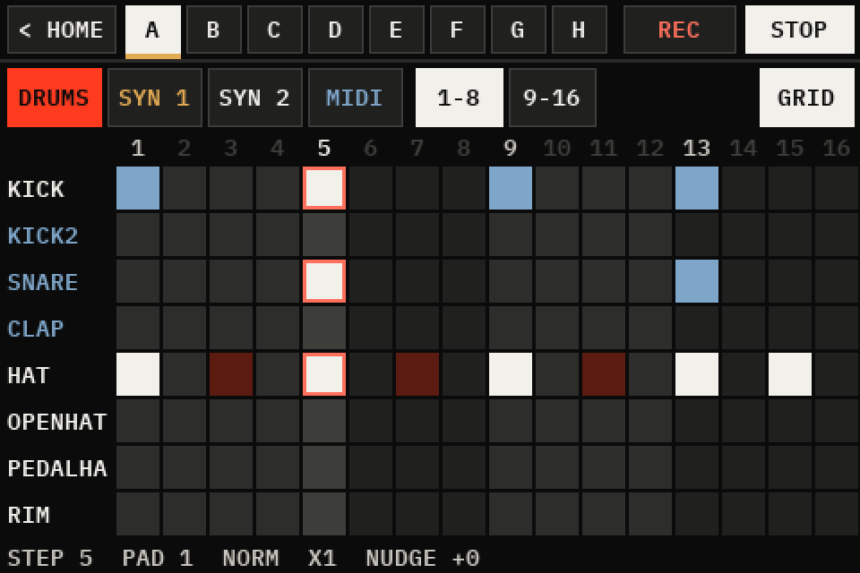
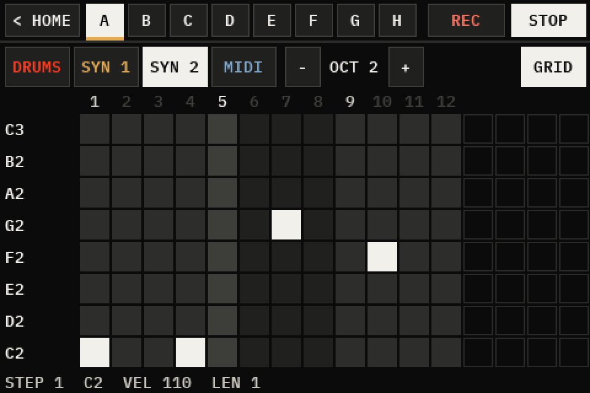
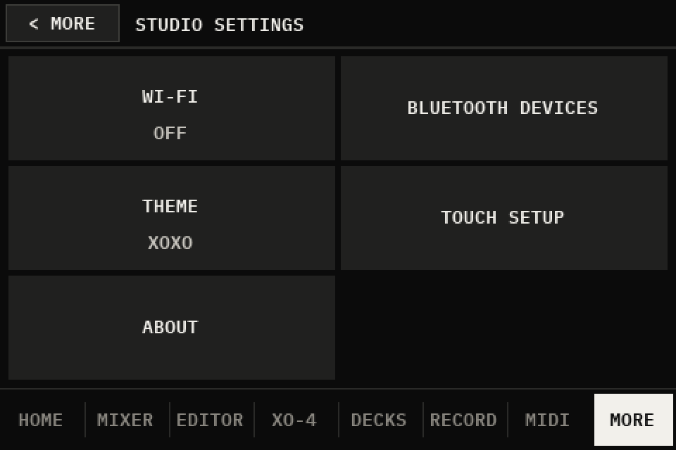
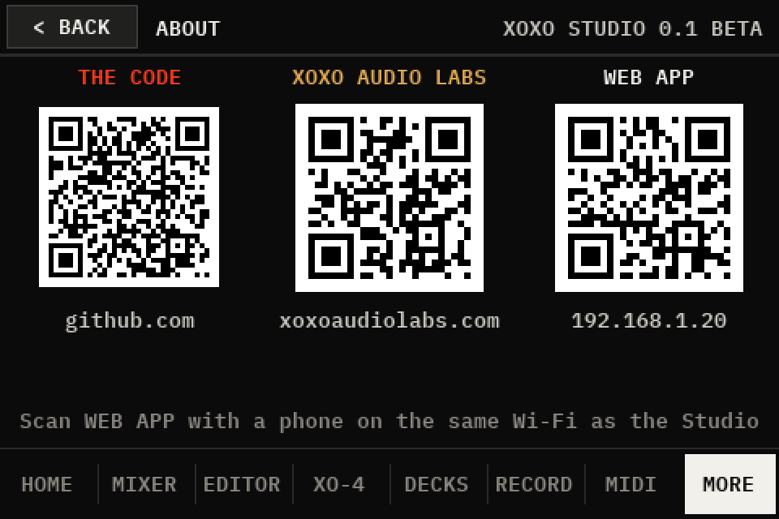

# XOXO Studio (beta 0.1)

> **This is a beta.** Version 0.1 BETA has been built and used on two Raspberry Pi 3s, and much of it has been tried on them, but not all of it. Before relying on it, read [Tested](#tested) (what has and hasn't been tried on hardware) and [Known limitations](#known-limitations). The Pi 4 build, the one planned with the USB interface for a computer, hasn't been put together yet.

A portable studio on a Raspberry Pi with a 3.5" touchscreen, by XOXO Audio Labs: a groovebox (XO-4) with a 16-pad sampler, two DJ decks, a mixer and recorder for USB sound sources, MIDI routing, and a web app for a phone. It began as the FM-1 Companion Studio, with the FM-1 taken out, so it isn't tied to one instrument: it's made for USB and Bluetooth MIDI gear and USB sound sources. What it has been tried with so far is listed under [Tested](#tested).

The version shows on the boot screen and in MORE > STUDIO SETTINGS > ABOUT.

### The beta at a glance

| Part | Tried on hardware | Not yet tried |
|---|---|---|
| Install, boot, the touchscreen | on a Pi 3 B+ (Hosyond 3.5", SPI) and a Pi 3 B (UCTRONICS 3.5", HDMI) | a Pi 4; the Waveshare (A) and (C); a fresh install with the `xoxo35` screen set-up; the `--screen hdmi` option itself |
| XO-4 and the pads | used by hand on the screen; the sound measured on the Pi; the FX heard | finger drumming, live REC, RPT; XO-4's timing by ear; its MIDI track to real gear |
| Mixer and sound out | USB sources heard (two FM-1s, an Ember Nanocore, a USB mic), the DAC HAT's outs, a Bluetooth speaker; mute, solo and level measured | sound out of the Pi's own jack; CUE |
| DJ decks | played by touch, music from a USB drive | a controller (the Hercules, MIDI LEARN) |
| Two Studios linked | clock, start/stop, REC from the leader on both, the link's latency measured, over a 100 ft cable too | sound heard across by ear; REC from the follower |
| A Pocket linked | a Pocket linking and its sound into the Studio; its MIDI with a stand-in Pocket on a PC | the speaker handover; the mix back to a Pocket; a Pocket's FM-1s each on its own stream; linked REC with a Pocket |
| MIDI | network MIDI; a route sending clock to a USB device | notes from a Bluetooth or USB keyboard through the routes; arp and chord |
| Recording | takes started from the web page on two linked Studios | a take listened back on the Studio; the sample EDITOR |
| Web app | on a phone and a PC: the tabs, Settings, the MIDI grid; the theme and Latency changed from a phone | adding music from a phone; USB out and the link settings changed from it |
| Updates from the web app | installed from a local release file on the Pi | an update from GitHub; going back when a new version won't start (tried on a PC only) |

## Hardware

**The parts, their cost (about $129–138 from PiShop.us) and how they go together: [docs/BUILD.md](docs/BUILD.md).** In short:

- **Raspberry Pi 4** (1 GB), the planned build: its USB-C port is to make the Studio a USB audio + MIDI interface for a computer. **Not built or tried yet.** So far the Studio has run on a **Raspberry Pi 3 B+** and a **Pi 3 B** (its CPU load with everything running at once hasn't been measured: see [Known limitations](#known-limitations))
- A 3.5" touchscreen: the Hosyond 3.5" "3.5 inch RPi LCD" on the pins (ILI9486 display, XPT2046 touch; tried). Waveshare's (A), the same design, and (C) haven't been tried. Or the UCTRONICS 3.5" HDMI touchscreen: the picture on HDMI, its touch on the pins (tried on a Pi 3 B)
- A microSD card (16 GB or more)
- Sound out: a Bluetooth speaker (tried: a JBL Go 3), the InnoMaker DAC HAT's headphone and RCA outs (tried), or the Pi's own 3.5 mm jack (not yet heard on hardware). Bluetooth headphones haven't been tried
- A good power supply: a Pi 3 on a weak one runs under-voltage and slows down (seen on the second test Studio)
- Optional: the InnoMaker HiFi DAC HAT, USB MIDI keyboards and controllers (a keyboard's notes through the routes not yet tried), USB audio (a keyboard's own sound, an audio interface), a PiSugar 3 Plus battery (its charge is read: tried), a Hercules DJControl Inpulse 200 MK2 for the DJ decks (not yet tried on the Studio)

## Set up

1. **Flash the card** with Raspberry Pi Imager: your Pi (*Raspberry Pi 4*, or *3*), *Raspberry Pi OS Lite*. In its settings, set the hostname `XOXOStudio`, a user name and password, your Wi-Fi, and **enable SSH**.
2. **Boot the Pi** (give it a few minutes the first time).
3. **Get the app onto the Pi**, either way:
   - **From a download** (tried): on GitHub, *Code › Download ZIP*, unzip it, and from the unzipped `XOXO-Studio-main` folder:
     ```
     scp -r fm1-bt-bridge YOUR_USER@xoxostudio.local:~
     ```
   - **With git** (not yet tried; updates later are a `git pull`). On the Pi (`ssh YOUR_USER@xoxostudio.local`):
     ```
     sudo apt-get update && sudo apt-get install -y git
     git clone https://github.com/xoxoaudiolabs/XOXO-Studio.git
     ```
     and use `XOXO-Studio/fm1-bt-bridge` below.
4. **Install** over SSH, then reboot (it asks for your password once):
   ```
   ssh YOUR_USER@xoxostudio.local
   bash fm1-bt-bridge/install.sh
   sudo reboot
   ```
   Options, for the parts you have (e.g. `bash fm1-bt-bridge/install.sh --dac --screen c`):
   - `--dac`: the InnoMaker HiFi DAC HAT (it adds the DAC's driver to `config.txt`; tried). The DAC is then the Studio's master out: its headphone (aux) and RCA outs both carry the main mix, and MASTER in the mixer sets its level. The Pi's own 3.5 mm jack gets a copy, for headphones and CUE (not yet heard). A Bluetooth speaker gets a copy of the master (tried).
   - `--screen c`: the Waveshare 3.5" (C) (not yet tried).
   - Without `--screen`: the Hosyond 3.5" (the Waveshare (A) is the same design), with the Studio's own overlay, `xoxo35`: Raspberry Pi OS's `piscreen` with the panel started as the screen maker starts it (blacker blacks; `config/xoxo35.sh` makes it on the Pi). The overlay was made and used on a running Studio; a fresh install with it hasn't been tried yet.
   - `--screen hdmi`: the 3.5" HDMI touchscreen (UCTRONICS): HDMI sent 720x480, which the screen scales to its panel, and its touch on SPI CE0 with its interrupt on GPIO 25. An SPI screen's overlay from before is switched off (it holds the same pins). These settings were tried, set by hand; the option itself hasn't been run yet.
   - On a Pi 4 the installer also sets up the USB interface (its USB-C port), with nothing to choose. (Written, not yet tried on a Pi 4.)
   On the first start the Studio asks for the touch setup (four targets) before HOME.

**Updating from the web app:** Settings > Software shows the version installed and the newest release on GitHub (tags `v0.1`, `v0.2` …). **Update…** asks for a hold on the Studio's screen, then installs that release with its own installer and restarts the app; if the new version doesn't start, the one before is put back. The update replaces the app's code and system files only: settings, pairings, kits, songs, samples, recordings and plug-ins are kept elsewhere and aren't touched, and nor are the boot settings (`config.txt`, `cmdline.txt`: the screen, the DAC), which change only when `install.sh` is run by hand. A Studio installed before 0.1 needs `install.sh` run by hand once first. Tried so far: an install from a local release file on the Pi, the way the update runs it (the boot files unchanged, every file still the user's). Not yet tried: an update from GitHub, the hold on the screen starting one, and going back on the Pi (tried on a PC only).

**Updating with git** (not yet tried): on the Pi, `cd XOXO-Studio && git pull && bash fm1-bt-bridge/install.sh`, then `sudo reboot`.

## The web app

At `http://xoxostudio.local` (or the address in MORE > STUDIO SETTINGS > ABOUT, as a QR code). It's the same web app as the FM-1 Companions' (Studio and Pocket): it shows what each box has. Served from this box it's named XOXO Studio, with its own home-screen app id, so a phone can keep it beside a Companion's.

Its tabs:
- **Status:** what you play with: the tempo, start / stop, the metronome, speaker, volume, the mixer (with DECKS while they play), a linked Pocket, keyboard, Record
- **Studio:** XO-4's patterns A–H, Play / Stop, MIDI IN and the synths' starting sounds; the pads' kits; what's on each DJ deck; the Studio DJ Music folder, where tracks can be added from the page (not yet tried from a phone)
- **MIDI:** the routes and presets. On a phone the routes' grid stands its destinations' names up, so every route fits across the screen
- **Library** (samples), **Editor**, **Rec** (the recordings)
- **Settings:** the Studio's own: the clock's FOLLOW / BOX and click level, the audio rate and Latency, USB out, the Studio link (Follow Studio, what a Pocket sends, the mix back, linked REC), the screen's theme, About (the version, Wi-Fi, links) and Software (updates)

## What's inside

The pictures are drawn on a PC by the Studio's own drawing code with a made-up studio (`python tools/studio_screens.py docs/images`), at twice the screen's 480×320: they're not photos of the device.

EDITOR, XO-4, DECKS and RECORD are full screen: "< HOME", top left, leads back. MIXER, MIDI and MORE keep the tab bar and have "< HOME" too.

### HOME

The tempo with − / +; every source (each USB device, the pads, XO-4, the decks while they run) and the speaker, each with a small bar and a % for its mixer level (beside a source's name: USB, its input pair, or a plug-in's words for it); REC, START, TAP.


### MIXER and RECORD

Every source a level, with M (mute) and S (solo) above its fader (also on the web page; HOME says MUTE or OFF), recorded as one mix (or a part each), with meters. Mute and solo leave CUE and Record parts as they are, and a restart clears them.


### EDITOR

The sample editor (full screen): a recording or a sample trimmed, faded, its note found, saved as a new sample, or put straight on a pad (TO PAD). Not yet tried on hardware.


### XO-4

The Studio's own groovebox, still growing (`fm1-bt-bridge/xo4.py`, `xo4synth.py`, `deskxo4.py`). The tab is used by hand on the Studio's screen and its sound measured there; what hasn't been tried on hardware is in [Tested](#tested). The 808 KIT is loaded on the first start.

- **Four tracks on the box's beat grid:**
  - **DRUMS** is the 16-pad sampler (notes 36–51 play it from the MIDI routes, as SMP): each hit with its level (NORM, GHOST, SOFT, HARD) and ratchet (X1–X4).
  - **SYN 1** and **SYN 2** are two-operator FM synths, with chords of up to four notes.
  - **MIDI** goes out through the routes, as the source XO4.
- **Patterns:** A–H, changing on the next bar. Each track has its own length, up to 64 steps.
- **Sound:** a source of its own, XO-4, in the mixer, the meters and recordings.
- **The XO-4 tab:**
  - **Header:** < HOME, the patterns A–H, REC (live: pads played go onto DRUMS while it plays) and PLAY / STOP.
  - **Track row:** the track, its length LEN − / +, HOLD CLR, and GRID.
  - **Steps:** 16 a page.
  - **Step row:** the pages, then the selected step's VEL and LEN.
  - **DRUMS:**
    - **The pads:** played (they sound while held, playing or not) and picked for the steps: the steps put the picked pad on or off.
    - **The hit just put on:** its LEVEL, ratchet and the step's NUDGE − / +. QUANT: live REC on the grid, or where it was played.
    - **KIT:** the kits (load, save, new). **RPT:** note repeat. **FX:** the sixteen punch-in FX (on the pads' sound). **PADS:** the 16 pads big, 4×4, full screen, with KIT, RPT, FX, REC and EDIT above them. **MIDI IN:** off at first, so a synth or the Pocket on the MIDI routes plays only itself; on, the routes' SMP column plays the pads (and live REC records them). Clock and start/stop still reach the pads either way. **EDIT:** a tap opens the pad's page (its sample, level, pan, tune, mode, choke; sampling into it, trimming it).
  - **SYN 1, SYN 2, MIDI:**
    - **The note keys:** OCT, KEY, SCALE, and 14 keys, which offer only the scale's notes.
    - **FX:** XO-4's own sixteen punch-in FX on the two synths' sound (hold one, or LATCH it), apart from the pads' FX.
    - **Placing a step:** tap an empty step to place the last notes and select it. Keys add notes to it or take them off, four at most.
    - **Emptying a step:** tap the selected step again.
  - **Hearing it:** while stopped, what you tap sounds.

| | |
|---|---|
| <br>**DRUMS** | <br>**SYN 1** |
| <br>**PADS** | <br>**The synths' FX** |

**GRID** shows the whole pattern at once, as on XO-4 Pocket: a row a sound (DRUMS: pads 1–8 or 9–16) or a note of the scale (SYN 1, SYN 2, MIDI: OCT − / + moves it), 16 steps across (P 1/2 … for a longer track), the playhead lit. A tap puts the row's sound or note on the step or takes it off; held, the step is emptied. The bottom line says what's on the step last tapped.

| | |
|---|---|
| <br>**GRID, DRUMS** | <br>**GRID, SYN 2** |

**SOUND** (SYN 1, SYN 2): the synth's page. Six starting sounds (KEYS, BASS, BELL, PLUCK, PAD, LEAD) and its settings, each − / + (held: four steps): RATIO, BRIGHT, BR DECAY, BR HOLD (how the brightness falls, and what stays), ATTACK, DECAY, SUSTAIN, RELEASE, LEVEL. HEAR plays the track's last notes; while stopped, a change does.


The SAMPLER tab and its own step sequencer are gone: a kit's pattern from it moves into the drums of XO-4's first pattern with empty drums, the first time that kit is used. What XO-4 can't do yet is under [Known limitations](#known-limitations).

### DECKS

Two DJ decks (full screen), from the Studio DJ Music folder or a USB drive, played by touch (tried), a Hercules DJControl Inpulse 200 MK2 (its mapping is built in; not yet tried on the Studio), or another MIDI controller after MIDI LEARN (not yet tried). Each deck has its own FX (ECHO on the beat, REVERB, FLANGER, BRAKE: FX tapped on or off, held for the next one; echo and reverb ring out).


### MIDI

Routes between Bluetooth MIDI, each USB MIDI device, network MIDI (a DAW) and the pads, with channels, transpose, velocity, chord memory and an arpeggiator per route. On hardware so far: network MIDI, and the clock sent out a route to a USB device. Notes from a keyboard through the routes, arp and chord are tried on a PC only.


### MORE and STUDIO SETTINGS

**MORE:** PLAYING, AUDIO and MIDI settings, PLUG-INS (the plug-in host, tested on a PC only: plug-ins themselves are separate projects, such as the FM-1 Companion plug-in, and none ships with this beta), STUDIO SETTINGS and SHUT DOWN (not yet tried from the screen). **STUDIO SETTINGS:** Wi-Fi, the theme, the touch setup, and ABOUT (the version, and QR codes for a phone: the Studio's code on GitHub, the XOXO Audio Labs website, and this Studio's web app at its address on the network now).

| | |
|---|---|
| <br>**MORE** | <br>**STUDIO SETTINGS** |
| <br>**ABOUT** | |

### Linking boxes, and USB out

- **The Pocket by Ethernet:** an FM-1 Companion Pocket on a cable straight to the Studio (no router needed: both take a link-local address) joins the Studio's network MIDI as NET. MIDI goes both ways, and the Studio's clock leads: its clock to NET (Box>NET) is on from the start. The Pocket's sound comes over the link too (RTP on UDP 46000) and shows as POCKET in HOME, the mixer and recordings while the Pocket is linked; the Studio is meant to keep the Bluetooth speaker while the Pocket lets go of its own (that handover not yet tried). A Pocket that splits its FM-1s (up to three) sends each on a stream of its own (UDP 46002, 46004, 46006) and a network MIDI session of its own: each FM-1 plugged into it is then a mixer channel and a device in the routes, POCKET FM-1 A-C (FM-1 E-G with the separate FM-1 Companion plug-in), and POCKET leaves the mixer. (Tried: a Pocket linking over the cable and its sound as POCKET; the MIDI with a stand-in Pocket on a PC. Not yet tried: its FM-1s each on its own stream.)
- **The link as a snake:** the Studio's master goes back to a linked Pocket over the same cable (RTP on UDP 46010, the Pocket's own format), for headphones at the Pocket: MORE > AUDIO > **Mix to Pocket**, on at first (not yet tried with a Pocket; tried to a Studio, below). MORE > AUDIO > **Pocket sends** is what comes from the Pocket: **MIX** (its own gear mixed, one stream, POCKET in the mixer; the setting at first), **FM-1s** (each of its FM-1s a channel of its own: four streams) or **MIDI ONLY**. The Pocket reads both in the Studio's `/api/status` (`link_audio`, `link_return`) and follows. MORE > AUDIO > **Latency** lowers the Studio's audio block and the link's receive buffer together: SAFE (1024 samples, 44 ms buffer), LOW (512, 24 ms), LOWER (256, 18 ms), LOWEST (128, 15 ms): the buffer holds one of the Pocket's blocks (it goes no lower than 512) and one of the Studio's. The lowest a Pi 3 plays without clicks is still to be found by ear.
- **Linked REC:** linked, REC on one box starts a take on both, and STOP stops both (MIDI Machine Control Record and Stop over the link). Each box records its own gear: with **Record parts** on, a file a source, so one take is every track of both boxes. A linked take has a note beside it (`<take>.wav.link.json`): how long after its REC its first sample landed (`first_sample_after_trigger_ms`), to line the two boxes' files up by. MORE > AUDIO > **Linked REC**, on at first. (Tried between two Studios, from the leader's web page; REC from the follower not yet. With a Pocket it needs the Pocket to answer and send MMC, which is the Pocket's side, and it hasn't been tried.)
- **Two Studios linked (Follow Studio):** MORE > AUDIO > **Follow Studio** on one Studio links it to another on the network or a cable, as a Pocket links: the other one leads. The one following takes its clock (tempo, Start and Stop) and passes it to its own gear along its **Box** routes, as its own clock would go (an FM-1 on Box> follows the leader; not where its NET route to the same device is on, so never twice), sends its notes back (never clock), and its master goes to the leader over the link (RTP on UDP 46020), where it's a mixer channel, STUDIO, beside a Pocket's POCKET. With **Mix to Pocket** on, the leader sends the follower its mix back (UDP 46012) less STUDIO, the follower's own sound (a mix-minus: it never hears itself late, and nothing goes round), and the follower plays it on an output its link doesn't send from: USB out, or the jack when the jack isn't its master (with only the master itself, nowhere). The one following takes the leader's **Latency** step too (it reads it every 10 s), so both work in the same block, and the leader's STUDIO buffer is sized for a Studio, not a Pocket: whole packets of 6.458 ms (PipeWire's receiver asks for that), 2 at LOWER and LOWEST (12.92 ms), 4 at LOW, 7 at SAFE. A Studio never follows itself or a Studio that's following another, and while it follows, it turns a Pocket's link away (network MIDI's NO), so the Pocket links to the leader. (Tried: the clock, start/stop, REC from the leader, the streams measured on the Pi and the link's latency. Not yet: sound heard across by ear.)
- **The link in the journal:** each network MIDI peer linking, linking again, leaving (BY) or forgotten after going quiet is a line in the system journal (`journalctl | grep "network MIDI"`). A Pocket or a Studio following is forgotten after 25 s without a sync, a computer after 90 s.
- **USB out:** with no DAC HAT, a USB audio interface's output gets a copy of the master (beside the Pi's jack or a Bluetooth speaker, or as the master when there's neither). MORE > AUDIO > **USB out**, shown while one is plugged in: AUTO (the first whose card has no MIDI, so an interface rather than a synth; an FM-1 has no output at all), one picked by name, or OFF. MASTER in the mixer sets its level (as a DAC HAT's). (Tried: a test tone measured at an interface's output; not yet heard by ear.)

## Known limitations

- **The Pi 4 build isn't built or tried yet:** the Pi 4 itself, the Studio as a computer's USB audio + MIDI interface, the Waveshare (C) screen, the DAC HAT on a Pi 4, the passive case. The software for it is written and tested on a PC only.
- **Not everything is tried on hardware.** Parts of the Studio have only run on a PC so far: see [Tested](#tested) for what has and hasn't been tried on a Pi.
- **Wi-Fi can stop answering.** Twice (2026-11-02 and 03) the Studio still answered ping on Wi-Fi but nothing else (no SSH, no web page, from a PC or a phone); the first time, a reboot of the Studio brought it back. The cause isn't found.
- **A Bluetooth speaker can come up silent.** Once, a JBL Go 3 switched on came up connected but silent, even after the Studio's own reconnect; another reconnect (switching the speaker off and on, or SPEAKER on the screen) brought it back. It played after each of two later power cycles. The cause isn't found.
- **Two hardware setups so far:** a Raspberry Pi 3 B+ with the Hosyond 3.5" SPI touchscreen (ILI9486 / XPT2046), and a Pi 3 B with the UCTRONICS 3.5" HDMI touchscreen. Other Pis and other screens haven't been tried, and the screens are drawn for 480×320 only.
- **USB out:** only with no DAC HAT (with one, the DAC is the master out and a USB interface gets nothing).
- **Two Studios linked: the pads are the slow part.** The link itself measured about 12–22 ms one way (see [Tested](#tested)). A pad's sound passes a 1024-frame pipe, a block written ahead and a 10 ms player before the Studio's mixer: about 40–50 ms, worked out from the code, not measured. So a pad played across the link spends most of its round trip there (XO-4's synths the same).
- **CPU.** Each part was measured on its own on a Pi 3 B+ (see [Tested](#tested)): XO-4 about 30% of one core while it plays, the pads about 20%, both decks playing 28% (49% with REVERB on both). Everything running at once hasn't been measured.
- **XO-4:**
  - Patterns can't be copied yet.
  - The synths can't be played live from a keyboard yet: XO-4 isn't a MIDI destination in the routes.
  - Eight patterns (A–H), up to 64 steps a track, four notes a step; a pattern change waits for the next bar.
- **DJ decks:** one FX at a time a deck. The Hercules DJControl Inpulse 200 MK2 has its own mapping; other controllers go through MIDI LEARN, which hasn't been tried with real hardware.
- **Speaker battery:** shown only when the speaker reports its battery to the Pi's Bluetooth (BlueZ). Many speakers don't, and then nothing shows.
- **Web page:** plain HTTP on the local network (`http://xoxostudio.local`), no password: anyone on the same network can use it. (An update from it still needs a hold on the Studio's screen.)
- **Old names inside:** some names in the code still say fm1 (the `fm1-bt-bridge` folder, `~/fm1-library`, the service names). They're internal, and they're left as they are for now.

## Tested

**On hardware** (2026-10-28: a Raspberry Pi 3 B+ on Raspberry Pi OS Lite, Trixie, 64-bit; a 3.5" ILI9486 / ADS7846 touchscreen; a PiSugar battery):
- installed from the GitHub ZIP as above: the installer ran to the end with no errors in its log
- after the reboot the app, its sampler and the web page start; the screen and the touch are found; the settings hold a touch calibration and a theme picked on the screen
- the battery's charge is read, with a green bolt beside its percent while it charges that goes when the charger is unplugged (2026-11-01, the user's report)
- the web page loads from a PC at `xoxostudio.local`, as XOXO Studio, with its own manifest and icon
- the tab bar with DECKS on it looks right on the Studio's screen
- XO-4's FM synth: 8 voices (two tracks' 4-note chords) take 22% of one core, measured with the app running; it writes its demo WAV there (the demo not yet listened to)
- XO-4's engine, with a demo pattern put in by hand and the box clock started from the web page: the XO-4 source and the pads (the 808 KIT, played by XO-4's drum track) both carry sound, measured by recording each source on the Pi (peaks 0.66 and 0.81); XO-4 takes about 30% of one core while it plays, the pads about 20%
- the XO-4 tab, used by hand on the Studio's screen: works well (the user's report, 2026-10-28)
- XO-4's GRID on the Studio's screen (2026-11-02): its cells hit by finger, "works well" (the user's report); the screen grabbed on the Pi showed it as drawn on the PC
- "< HOME" at the top left of MIXER, SAMPLER, RECORD, MIDI and MORE looks right on the Studio's screen (the user's report; the SAMPLER tab has since become XO-4's DRUMS)
- SAMPLER and RECORD full screen (no tab bar) look right on the Studio's screen (the user's report; SAMPLER since replaced as above)
- HOME's tempo - / + beside the BPM work well on the Studio's screen (the user's report)
- HOME listing every source with its mixer level looks right on the Studio's screen (the user's report; the decks' row not yet seen with the decks playing there)
- the FX (the pads' punch-in FX, XO-4's synth FX, the decks' ECHO, REVERB, FLANGER, BRAKE) sound good on the Studio (the user's report, 2026-10-28)
- XO-4's MIDI IN: starts off on the Studio, the app runs with it (its effect on notes tested on the PC only)
- the web page's Studio tab (2026-10-29): it loads from the Studio and shows XO-4, the kits and the decks; XO-4's pattern changed from the page and back (checked in the page's status). Not yet tried from a phone: MIDI IN, the sounds, loading a kit, adding music, the decks' rows while they play, the DECKS level
- the Pocket's sound over the link (2026-10-29, over Wi-Fi): the Studio makes POCKET its own mixer channel while the Pocket is linked, an FM-1 on the Pocket plays out of the Studio's speaker, and it comes back after the Pocket's sender restarts (the user's reports). Not yet tried: the speaker handover, the latency by ear
- the Pocket on a direct Ethernet cable (2026-10-29): the Studio's eth0 takes 169.254.115.88 and keeps it past NetworkManager's DHCP timeout, the Pocket finds the Studio there by DNS-SD and links over it, and the Pocket answers a ping over the cable in about 1.5 ms. The Pocket's sound over the cable: "seems good now" (the user's report, after the Pocket's bridge restarted; before that it sent only silence, which the Pocket session traces to the FM-1's input needing to be opened afresh). Not yet tried after a reboot
- the Pocket link's Studio side, with a stand-in Pocket on a PC over Wi-Fi: it joins the Studio's network MIDI as "FM-1 Companion Pocket" and gets the Studio's clock (2026-10-29); the Studio's Ethernet setting is loaded by NetworkManager with no error
- the DJ decks played by touch alone (no controller), music from a USB drive, out of a JBL Go 3 over Bluetooth (the user's report, 2026-10-28, after the fix for their volume starting at 0)
- the DJ decks' CPU (2026-10-28, the Pi 3 B+, both decks playing): 28% of one core without FX, both ECHO 31%, both FLANGER 40%, both REVERB 49%
- the InnoMaker HiFi DAC HAT on the Pi 3 B+ (2026-11-01): `install.sh --dac` adds its driver, the Pi lists it as BossDAC, the Studio makes it the master out (every mixer channel linked to it, the Pi's jack a copy) and both its headphone (aux) and RCA outs play (the user's report). A Bluetooth speaker's copy of it plays too (a JBL Go 3, 2026-11-02, the user's report). Once that morning the JBL, switched on, came up connected but silent, even after the Studio's own reconnect; another reconnect brought it back, and it played after each of two later power cycles (the cause isn't found). Not yet tried: CUE on the Pi's jack beside it
- USB sound sources in the mixer (2026-11-02, the Pi 3 B+ with the DAC HAT): two FM-1s, an Ember Nanocore and an ATR2100x USB mic plugged in at once, each its own mixer channel beside the pads and XO-4 (six, all linked to the DAC's master, checked on the Pi), and every source heard out of both the DAC's outs and the JBL Go 3 (the user's report). Not yet tried: their levels set by ear, mute and solo
- the mixer's mute, solo and level, measured (2026-11-02, the same Studio, `tools/mixer_test.py`): a 997 Hz tone at -20 dBFS into XO-4, set from the web page's commands and measured at the DAC's master and the JBL's sink on the Pi. It arrived at -20.0 dBFS at both; muting XO-4 silenced it and unmuting brought it back; soloing SAMPLER silenced it and unsoloing brought it back; soloing XO-4 kept it; XO-4's level at 50 took it down 18 dB and 100 brought it back; every setting was back as it was after. 10/10, twice. Not by ear; not tried on the USB channels or CUE
- two Studios linked (2026-11-01: a Pi 3 B+ with the DAC HAT leading, a Pi 3 B with the 3.5" HDMI touchscreen following, on an Ethernet cable and over Wi-Fi): Follow Studio links them (the leader's journal: "XOXO Studio Link on FM-1CompanionStudio linked from 169.254.40.59"), the follower takes the leader's tempo (100 BPM), Stop and Start from the leader's web page stop and start both, REC and STOP from it start and stop a take on both, and the follower's master arrives on the leader's STUDIO channel (a stream, measured on the Pi; only silence so far: nothing made sound on the follower). Not yet tried: sound heard across, REC started on the follower, a Pocket and a Studio linked at once
- the link's own latency between two Studios (2026-11-01, a short Ethernet cable; the follower throttled to 600 MHz by under-voltage): a click into the leader's XO-4, its mix back to the follower, looped there straight into its link for the test, and back on the leader's STUDIO; the leader's output recorded both, the click and its copy, so the gap is the round trip to the sample (`tools/snake_time.py`, which says how). Settled (30-70 s after a Latency change; before that it starts high and comes down): LOWER 34-44 ms round trip, LOWEST 24-40 ms, so about 17-22 ms and 12-20 ms one way; no receiver overruns. While settling, LOWER and LOWEST both read 85-104 ms. Over a 100 ft Ethernet cable (2026-11-02, LOWER, the same tool; the follower under-voltage again by the end, at 600 MHz; the cable's own ping 0.65 ms round trip): 106 ms at first, 60-64 ms a minute in, then 36-41 ms round trip (about 18-20 ms one way) for four readings over three minutes, and a last one with three clicks at 24-26 ms; receiver overruns not checked
- the leader's mix back to a following Studio (2026-11-01): the leader sent FELUCCA, SAMPLER and XO-4 but not STUDIO; a tone played into the leader's XO-4 arrived at the follower at the level it was sent (measured on the Pi) and plays on its USB interface
- the leader's clock out a following Studio's Box routes (2026-11-01): with Box>U:Felucca on, the follower sent its FM-1 clock at the leader's 100 BPM (122 bytes in 3 s, counted by the kernel), none with the route off and again with it on, switched from the web page; the FM-1 followed (the user's report)
- USB out (2026-11-01, the Pi 3 B with no DAC HAT, a PCM2902 "USB Audio CODEC" interface and an FM-1 plugged in): AUTO picked the interface, not the FM-1, and a test tone played into the master came out of the interface's output (measured at its output, on the Pi). Not yet heard by ear
- the latency between two Studios (2026-11-01, Tester Tools 0.2 on the leader: a note out over network MIDI, the follower's first pad playing it, its sound timed back on the leader's STUDIO; the follower throttled to 600 MHz by under-voltage): SAFE 172 ms round trip, LOW 128, LOWER 87-107 (two runs), LOWEST 87; the follower took each step from the leader by itself, and the leader's STUDIO receiver had no overruns at any step in those 6 minutes
- the 3.5" HDMI touchscreen (2026-11-01, the Pi 3 B that ran FM-1 Companion Studio): with its own touch overlay and no SPI screen's, the Studio draws on it full screen (720x480) and its touch works after the touch setup (the user's report). With the SPI screen's overlay added as well (what `install.sh` did before `--screen hdmi`), touch was dead
- the screen's `xoxo35` overlay (2026-11-02, the Hosyond 3.5" on the Pi 3 B+): with `piscreen`'s start-up the backlight showed through and the blacks were washed out; with the maker's the blacks are blacker and the near-black steps of a test card (8, 16, 24 of 255) still show (the user's report). The Studio starts and draws with it. VCOM tried live from 0x91 down to 0x4A; the maker's 0x91 kept. `config/xoxo35.sh` made the same overlay byte for byte on the Pi. Not yet checked: touch with it; `install.sh` making it on a fresh install, or switching a box set up with `piscreen`
- the beta's version and MORE > ABOUT (2026-11-03, the Pi 3 B+): ABOUT's WEB APP code scanned with a phone opens the Studio's web app (the user's report); all three codes decode to their addresses (read back from the drawn page on a PC with OpenCV). Not yet seen on the Studio: the boot screen's new version line (drawn on a PC only); THE CODE needs the GitHub repo public to open for others
- MORE > STUDIO SETTINGS (2026-11-03, the Pi 3 B+): Wi-Fi, the theme, the touch setup and ABOUT moved there, used on the Studio's screen (the user's report)
- the web app on a phone (2026-11-03): the MIDI routes' grid fits across the phone's screen with every destination (the user's report; checked at 375 px wide in a browser too, every tab with nothing wider than the screen)
- the web app's Settings tab (2026-11-03, the Pi 3 B+, at 375 px wide in a browser): the clock, audio, Studio link, screen, About and Software sections show the Studio's settings as they are; the seven tabs fit across; Status keeps what's played with. From a phone, the theme and Latency changed from the page: "works well" (the user's report). Not yet tried from the page: USB out, the link's settings
- updating from the web app (2026-11-03, the Pi 3 B+): `install.sh` run by hand installed `fm1-update` and its sudoers line (the sudoers file checked by `visudo`); then `fm1-update` installed this code from a local release file, as root for the user, as the web app's update does: `config.txt` and `cmdline.txt` unchanged (their checksums), no file in the user's folders left owned by root, the app and the web page running again. Settings > Software shows v0.1 installed and, with the repository private and untagged, "no releases on GitHub yet". Not yet tried: an update from GitHub (needs the repository public and a newer tag), the hold-press on the screen starting one, the put-back when a new version doesn't start (tested on a PC only)
- the link's journal lines (2026-11-01): linked, left (BY) and forgotten lines seen in the Studio's journal, from a stand-in computer on a PC, a Pocket and a Studio following

**Not yet tried on hardware:** a Pi 4 and everything of its build (the USB interface, the Waveshare (C), the case); sound heard out of the Pi's 3.5 mm jack; XO-4 by ear (its timing against the pads, the MIDI track to real gear); the mixer by ear (levels, mute and solo) and CUE; a Pocket's FM-1s on their own; linked REC with a Pocket; a take listened back on the Studio; XO-4's DRUMS by hand (finger drumming, levels, ratchets, nudge, live REC, RPT, the kit pages from XO-4); the EDITOR tab and the sample editor; notes from a Bluetooth or USB keyboard through the MIDI routes, arp and chord; the DJ decks with a controller (MIDI LEARN, a Hercules); Bluetooth headphones; shutting down from the screen; an update from GitHub; sound heard across two linked Studios.

**On a PC:** the test suite passes (2026-11-03: 219 tests; each `tests/test_*.py` with its own runner, `tests/test_desk.py` and `tests/test_netmidi.py` through pytest. Run all at once in one pytest process, some fail on each other's leftovers: run them file by file). The screen pictures under [What's inside](#whats-inside) are drawn by the Studio's own code on a PC.

## License and credits

XOXO Studio is GPL-3.0 (see [LICENSE](LICENSE)), like SLOOP, which parts of it come from. It began as the FM-1 Companion Studio (xoxoaudiolabs/FM-1-Companion, GPL-3.0). Later from FM-1 Companion too (2026-11-01): the Pocket's Studio link (finding a Studio by DNS-SD, inviting it, keeping it synced: `netmidi.py`'s Invitation), which Follow Studio uses, and the 3.5" HDMI touchscreen's support (`device.hdmi35`, `desk.ScaledFb`, the installer's setup for it). And (2026-11-03) the web app's one-click update: `update.py`, `config/fm1-update`, the installer's update mode and `tests/test_update.py`, ported from FM-1 Companion's.

**From SLOOP** ([isod89/sloop-fm1](https://github.com/isod89/sloop-fm1), GPL-3.0), rewritten in Python here: the pads' step sequencer (its `seq.c`), and the sixteen punch-in FX (`punch.c`). The Studio's look is its own now (`xoxostyle.py`: the XOXO theme from the XOXO Audio Labs website's colours and type, and eight Studio themes); it no longer uses SLOOP's palettes or font.

**Copied into this repository** (each with its licence beside it):

| What | From | Licence |
|---|---|---|
| `fm1-bt-bridge/vendor/fonts/` (Anton) | The Anton Project Authors, from [google/fonts](https://github.com/google/fonts) ([VENDORED.md](fm1-bt-bridge/vendor/fonts/VENDORED.md)) | SIL Open Font License 1.1 |
| `fm1-bt-bridge/vendor/fonts/` (IBM Plex Mono) | IBM Corp., from [google/fonts](https://github.com/google/fonts) ([VENDORED.md](fm1-bt-bridge/vendor/fonts/VENDORED.md)) | SIL Open Font License 1.1 |
| `fm1-bt-bridge/kits/808/` (the 808 KIT's sixteen sounds) | Michael Fischer's recordings of a Roland TR-808 (1994), from [tidalcycles/sounds-tr808-fischer](https://github.com/tidalcycles/sounds-tr808-fischer) ([CREDITS.md](fm1-bt-bridge/kits/808/CREDITS.md)) | CC0 1.0 |

**The 3.5" screen's start-up values** in `config/xoxo35.sh` (the ILI9486 panel's power, VCOM and gamma registers) are the screen maker's, from the `tft35a` overlay in goodtft's [LCD-show](https://github.com/goodtft/LCD-show). That repository states no licence; only these register values are used, not its code or scripts.

Not affiliated with Roland or Hercules. TR-808 is a trademark of Roland Corporation; DJControl Inpulse is Hercules's (Guillemot Corporation).

**Built on** (installed by `install.sh` from Raspberry Pi OS's own packages, or already part of it; not copied into this repository, and each under its own licence):

| Software | What XOXO Studio uses it for | Licence |
|---|---|---|
| Raspberry Pi OS (Debian) and the Linux kernel | the system; the screen's drivers (fbtft, SPI, I2C); its `piscreen` overlay, which `config/xoxo35.sh` turns into the Studio's `xoxo35` on the Pi | GPL-2.0 (the kernel); Debian's packages each their own |
| the Device Tree Compiler (`dtc`) | making the `xoxo35` screen overlay | GPL-2.0-or-later |
| PipeWire (`pw-cat`, `pw-record`, `pw-loopback` …) and its Bluetooth plugin | all the sound: the mixer, Bluetooth audio, recording, the pads, the decks | MIT, with some parts LGPL-2.1-or-later |
| WirePlumber (`wpctl`) | PipeWire's session manager; levels | MIT |
| BlueZ | Bluetooth: speakers, Bluetooth MIDI | GPL-2.0-or-later (its libraries LGPL-2.1-or-later) |
| D-Bus | talking to BlueZ | GPL-2.0-or-later or AFL-2.1 (some parts MIT, BSD) |
| systemd | the app's services | LGPL-2.1-or-later (some parts GPL-2.0-or-later) |
| NetworkManager (`nmcli`) | Wi-Fi on / off | GPL-2.0-or-later (its libraries LGPL-2.1-or-later) |
| RealtimeKit (rtkit) | real-time priority for the sound | GPL-3.0-or-later (some parts MIT) |
| udisks2, exfatprogs, ntfs-3g | USB drives of music for the decks | GPL-2.0-or-later (udisks2's library LGPL-2.0-or-later) |
| Python 3 | the app itself | PSF License |
| Pillow | drawing every screen, the icons | the PIL Software License (MIT-CMU) |
| python-qrcode (`python3-qrcode`) | the QR codes in STUDIO SETTINGS > ABOUT | BSD-3-Clause |
| NumPy | meters, the sampler, the sample editor | BSD-3-Clause |
| mido and python-rtmidi (RtMidi) | MIDI | MIT |
| libsndfile, with mpg123 | the DJ decks reading MP3, FLAC, WAV, AIFF and Ogg | LGPL-2.1-or-later (some parts Apache-2.0); mpg123 LGPL-2.1 |
| dbus-python | BlueZ over D-Bus | MIT (some parts AFL-2.1 or GPL-2.0-or-later) |
| PyGObject | BlueZ's events (GLib) | LGPL-2.1-or-later |
| spidev, libgpiod's Python bindings, smbus2, i2c-tools | the pocket build's screen and keys; the PiSugar battery | MIT; LGPL-2.1-or-later; MIT; GPL-2.0-or-later |
| DejaVu fonts | the pocket build's text | Bitstream Vera / DejaVu licence (free) |

The licences are each project's own, as Debian lists them in each package's `/usr/share/doc/<package>/copyright` on the Pi: that file is the one to go by.
