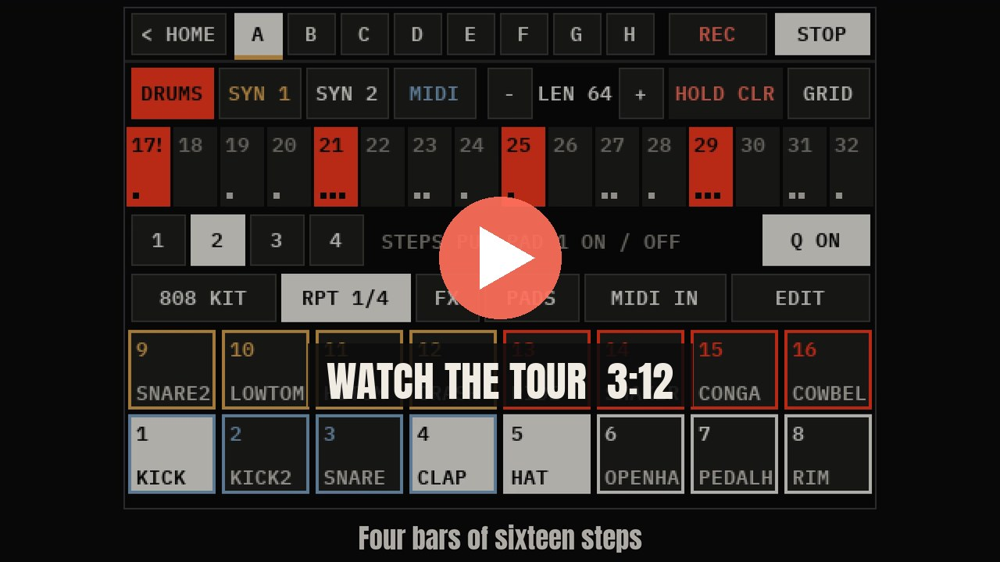

# XOXO Studio (beta 0.2.2)

[](docs/video/xoxo-studio-tour.mp4)

**[Watch the tour](docs/video/xoxo-studio-tour.mp4)** (3:36): every screen on a real Studio (a Pi 3 B+), with the Studio's own sound. The song, "Pocket Groove", was made on XO-4 with the Synths plug-in. Credits are at the end of the video.

A portable music studio on a Raspberry Pi with a 3.5" touchscreen, by XOXO Audio Labs: a groovebox (XO-4) with a 16-pad sampler, two DJ decks, a mixer and recorder for USB sound sources, MIDI routing, a web app for your phone, and, on a Pi 4, a USB audio + MIDI interface for your computer. It's made for USB and Bluetooth MIDI gear and USB sound sources, not tied to one instrument.

> **This is a beta.** Version 0.2.2 has been built and used on three Studios: two Raspberry Pi 3s and one Raspberry Pi 4. Much of it has been tried on them, but not all of it. Before relying on it, read [Tested](#tested) and [Known limitations](#known-limitations). Nothing here is claimed beyond what's been tried.

The version shows on the boot screen and in MORE › STUDIO SETTINGS › ABOUT.

## The beta at a glance

| Part | Tried on hardware | Not yet tried |
|---|---|---|
| Install, boot, touchscreen | Pi 4 (Waveshare 3.5" (C), DAC HAT); Pi 3 B+ (Hosyond 3.5" SPI); Pi 3 B (UCTRONICS 3.5" HDMI) | Waveshare (A); a fresh install with the `xoxo35` screen set-up; the `--screen hdmi` option itself |
| Pi 4 as a USB interface | Windows 11, no driver: audio and MIDI both ways | a DAW; macOS or Linux; the power/data splitter; latency |
| XO-4 and the pads | used by hand on the screen; the sound measured; the FX heard | finger drumming, live REC, RPT; XO-4's timing by ear; its MIDI track to real gear |
| Mixer and sound out | USB sources heard (two FM-1s, an Ember Nanocore, a USB mic); the DAC HAT's outs; a Bluetooth speaker; mute, solo and level measured | the Pi's own 3.5 mm jack; CUE |
| DJ decks | played by touch, music from a USB drive; SYNC to XO-4 measured | a controller (the Hercules, MIDI LEARN) |
| Two Studios linked | clock, start/stop, REC from the leader on both, the link's latency measured | sound heard across by ear; REC from the follower |
| A Pocket linked | its link and its sound into the Studio | the speaker handover; the mix back to a Pocket; its FM-1s on their own streams |
| MIDI | network MIDI; clock out a route to a USB device; a USB keyboard playing XO-4's synth (Pi 4) | a keyboard's notes out to other gear through the routes; arp and chord |
| Recording | takes from the web page on two linked Studios | a take listened back on the Studio; the sample EDITOR |
| Web app | on a phone and a PC: the tabs, Settings, the MIDI grid | adding music from a phone; USB out and the link settings from it |
| Updates | from GitHub on a Pi 3 B+ (v0.2.0, then v0.2.1); without a password on a Pi 3 B | going back when a new version won't start (tried on a PC only) |
| Shutting down | ends on SAFE TO UNPLUG (a Pi 3 B, SPI screen) | — |

## Hardware

**The parts, their cost (about $129–138 from PiShop.us) and how they go together: [docs/BUILD.md](docs/BUILD.md).** In short:

- **Raspberry Pi 4** (1 GB): the main build. Its USB-C port makes the Studio a USB audio + MIDI interface for a computer. Built once so far (2026-11-07). The Studio also runs on a **Raspberry Pi 3 B+** and a **Pi 3 B** (no USB interface there).
- **A 3.5" touchscreen** (480×320): the Waveshare 3.5" (C) (tried on the Pi 4), the Hosyond "3.5 inch RPi LCD" (tried; Waveshare's (A) is the same design, not tried), or the UCTRONICS 3.5" HDMI touchscreen (tried on a Pi 3 B).
- **Sound out:** the InnoMaker HiFi DAC HAT's headphone and RCA outs (both tried on a Pi 3 B+; its headphone out on the Pi 4), a Bluetooth speaker (tried: a JBL Go 3), or the Pi's own 3.5 mm jack (not yet heard). On a Pi 3, use a USB Bluetooth dongle for speakers (see [Known limitations](#known-limitations)).
- **A good power supply.** A Pi 3 on a weak one runs under-voltage and slows down, and its Wi-Fi drops (seen on a test Studio). A Pi 4 powered only from a computer's USB port runs under-voltage too: give it its own supply (through the splitter, docs/BUILD.md).
- **A microSD card** (16 GB or more).
- **Optional:** USB MIDI keyboards and controllers, USB audio (a keyboard's own sound, an audio interface), a PiSugar 3 Plus battery (its charge is read: tried), a Hercules DJControl Inpulse 200 MK2 for the decks (not yet tried on the Studio).

## Set up

1. **Flash the card** with Raspberry Pi Imager: your Pi (*Raspberry Pi 4* or *3*), *Raspberry Pi OS Lite (64-bit)*. In its settings, set a hostname (`XOXOStudio`; give a second Studio its own name), a user name and password, your Wi-Fi, and **enable SSH**.
2. **Boot the Pi** (give it a few minutes the first time).
3. **Get the app onto the Pi**, one of these ways:
   - **A release, downloaded on the Pi** (tried on the Pi 4). On the Pi (`ssh YOUR_USER@xoxostudio.local`), for the newest tag (here v0.2.2):
     ```
     curl -fsSL https://github.com/xoxoaudiolabs/XOXO-Studio/archive/refs/tags/v0.2.2.tar.gz | tar xz
     mv XOXO-Studio-0.2.2 XOXO-Studio && cd XOXO-Studio
     ```
   - **The ZIP from a computer** (tried on a Pi 3 B+): on GitHub, *Code › Download ZIP*, unzip it, and from the unzipped folder: `scp -r fm1-bt-bridge YOUR_USER@xoxostudio.local:~`
   - **With git** (not yet tried): `sudo apt-get install -y git && git clone https://github.com/xoxoaudiolabs/XOXO-Studio.git && cd XOXO-Studio`
4. **Install**, then reboot (it asks for your password once):
   ```
   bash fm1-bt-bridge/install.sh --dac --screen c
   sudo reboot
   ```
   Options, for the parts you have:
   - `--dac`: the InnoMaker HiFi DAC HAT (tried on a Pi 3 B+, and its headphone out on the Pi 4). The DAC is the master out: its headphone and RCA outs carry the main mix, and MASTER in the mixer sets its level. The Pi's own jack gets a copy for headphones and CUE (not yet heard). A Bluetooth speaker gets a copy of the master (tried). The Studio sets the DAC's analog stage to −6 dB as it starts, which halves its hiss in IEMs (heard quieter on the Pi 4); its loudest is 6 dB lower.
   - `--screen c`: the Waveshare 3.5" (C) (tried on the Pi 4: right side up).
   - No `--screen`: the Hosyond 3.5" / Waveshare (A), with the Studio's `xoxo35` overlay for blacker blacks (made and used on a running Studio; a fresh install with it not yet tried).
   - `--screen hdmi`: the UCTRONICS 3.5" HDMI touchscreen (its settings tried, set by hand; the option itself not yet run).
   - On a Pi 4 the installer also sets up the USB interface on its USB-C port, with nothing to choose (tried: see [The Pi 4 as a USB interface](#the-pi-4-as-a-usb-interface)), and the Studio plays more at once: up to 32 pad voices (16 on a Pi 3) and 8 notes a XO-4 track (4), so a chord rings on under the next (measured, not yet listened to).
5. **On the first start** the Studio asks for the touch setup (four targets) before HOME.

## Updating

**From the Studio or the web app:** MORE › STUDIO SETTINGS › SOFTWARE UPDATE on the screen, or Settings › Software in the web app, shows the version installed and the newest release on GitHub (its tags: `v0.2.2` …). **Update** (from the web app, after a hold on the Studio's screen) installs that release with its own installer and restarts the app; if the new version doesn't start, the one before is put back (tried on a PC only). Settings, pairings, kits, songs, samples, recordings and plug-ins are kept, and so are the boot settings (the screen, the DAC), Bluetooth and the network settings, which change only when `install.sh` is run by hand. Where the Studio's sudo asks for a password, the update installs the Studio's own files without one. A Studio installed before 0.1 needs `install.sh` run by hand once first.

Tried: a Pi 3 B+ updated itself from GitHub to v0.2.0 and then v0.2.1 (2026-11-07; v0.2.1's update left `config.txt` untouched); a Pi 3 B installed an update without a password (from a local release file). A Studio whose Wi-Fi has dropped says it couldn't ask GitHub: switching Wi-Fi off and on in STUDIO SETTINGS brings it back.

**With git** (not yet tried): `cd XOXO-Studio && git pull && bash fm1-bt-bridge/install.sh`, then `sudo reboot`.

## The web app

At `http://xoxostudio.local` (or the address in MORE › STUDIO SETTINGS › ABOUT, as a QR code). It's the same web app as the FM-1 Companions' (Studio and Pocket) and shows what each box has; served from this box it's named XOXO Studio, with its own home-screen app id.

Its tabs:
- **Status:** the tempo, start / stop, the metronome, speaker, volume, the mixer (with DECKS while they play), a linked Pocket, keyboard, Record
- **Studio:** XO-4's patterns A–H, Play / Stop, MIDI IN and the synths' starting sounds; the pads' kits; the DJ decks; the Studio DJ Music folder, where tracks can be added from the page (not yet tried from a phone)
- **MIDI:** the routes and presets (on a phone the grid's destination names stand up, so every route fits across)
- **Library** (samples), **Editor**, **Rec** (the recordings)
- **Settings:** the clock, the audio rate and Latency, USB out, the Studio link, the screen's theme, About, and Software (updates)

## What's inside

The pictures are drawn on a PC by the Studio's own drawing code with a made-up studio (`python tools/studio_screens.py docs/images`), at twice the screen's 480×320: they're not photos of the device.

The tab bar: HOME, MIXER, MIDI, RECORD, XO-4, EDITOR, DECKS, MORE. EDITOR, XO-4, DECKS and RECORD are full screen: "< HOME", top left, leads back. MIXER, MIDI and MORE keep the tab bar and have "< HOME" too.

### HOME

The tempo with − / +; every source (each USB device, the pads, XO-4, the decks while they run) and the speaker, each with a small bar and a % for its mixer level (beside a source's name: USB, its input pair, or a plug-in's words for it); REC, START, TAP.


### MIXER and RECORD

Every source a level, with M (mute) and S (solo) above its fader (also on the web page; HOME says MUTE or OFF), recorded as one mix (or a part each), with meters. Mute and solo leave CUE and Record parts as they are, and a restart clears them.


### EDITOR

The sample editor (full screen): a recording or a sample trimmed, faded, its note found, saved as a new sample, or put straight on a pad (TO PAD). Not yet tried on hardware.


### XO-4

The Studio's own groovebox, still growing (`fm1-bt-bridge/xo4.py`, `xo4synth.py`, `deskxo4.py`). The tab is used by hand on the Studio's screen and its sound measured there; what hasn't been tried on hardware is in [Tested](#tested). The 808 KIT is loaded on the first start.

- **Four tracks on the box's beat grid:**
  - **DRUMS** is the 16-pad sampler (notes 36–51 play it from the MIDI routes, as SMP): each hit with its level (NORM, GHOST, SOFT, HARD) and ratchet (X1–X4). The pads play in XO-4's own channel: one XO-4 in the mixer, the meters and recordings, with no SAMPLER channel. So a pad can't be sampled from XO-4 (that channel has the pads in it).
  - **SYN 1** and **SYN 2** are two-operator FM synths, with chords of up to four notes.
  - **MIDI** goes out through the routes, as the source XO4.
- **Patterns:** A–H, changing on the next bar. Each track has its own length, up to 64 steps.
- **Sound:** a source of its own, XO-4, in the mixer, the meters and recordings.
- **The XO-4 tab:**
  - **Header:** < HOME, the patterns A–H, REC (live: pads played go onto DRUMS while it plays) and PLAY / STOP.
  - **Track row:** the track, its length LEN − / +, HOLD CLR, and GRID.
  - **Steps:** 16 a page.
  - **Step row:** the pages, then the selected step's VEL and LEN.
  - **DRUMS:**
    - **The pads:** played (they sound while held, playing or not) and picked for the steps: the steps put the picked pad on or off.
    - **The hit just put on:** its LEVEL, ratchet and the step's NUDGE − / +. QUANT: live REC on the grid, or where it was played.
    - **KIT:** the kits (load, save, new). **RPT:** note repeat. **FX:** the sixteen punch-in FX (on the pads' sound). **PADS:** the 16 pads big, 4×4, full screen, with KIT, RPT, FX, REC and EDIT above them. **MIDI IN:** off at first, so a synth or the Pocket on the MIDI routes plays only itself; on, the routes' SMP column plays the track picked: on DRUMS the pads (and live REC records them), on SYN 1 or SYN 2 that synth. Clock and start/stop still reach the pads either way. **EDIT:** a tap opens the pad's page (its sample, level, pan, tune, mode, choke; sampling into it, trimming it).
  - **SYN 1, SYN 2, MIDI:**
    - **The note keys:** OCT, KEY, SCALE, and 14 keys, which offer only the scale's notes.
    - **Played from a keyboard:** with MIDI IN on (on the DRUMS page, or in the web app), a keyboard on the MIDI routes plays the synth picked, with its velocity, a sustain pedal, the pitch wheel (two semitones each way) and the mod wheel (a vibrato, up to half a semitone); back on DRUMS it plays the pads again. What's played isn't recorded onto the steps. Tried on the Pi 4 with a USB keyboard on SYN 1 and SYN 2, its pitch and mod wheels and a sustain pedal too (the user's report).
    - **FX:** XO-4's own sixteen punch-in FX on the two synths' sound (hold one, or LATCH it), apart from the pads' FX.
    - **Placing a step:** tap an empty step to place the last notes and select it. Keys add notes to it or take them off, four at most.
    - **Emptying a step:** tap the selected step again.
  - **Hearing it:** while stopped, what you tap sounds.

| | |
|---|---|
| <br>**DRUMS** | <br>**SYN 1** |
| <br>**PADS** | <br>**The synths' FX** |

**GRID** shows the whole pattern at once, as on XO-4 Pocket: a row a sound (DRUMS: pads 1–8 or 9–16) or a note of the scale (SYN 1, SYN 2, MIDI: OCT − / + moves it), 16 steps across (P 1/2 … for a longer track), the playhead lit. A tap puts the row's sound or note on the step or takes it off; held, the step is emptied. The bottom line says what's on the step last tapped.

| | |
|---|---|
| <br>**GRID, DRUMS** | <br>**GRID, SYN 2** |

**SOUND** (SYN 1, SYN 2): the synth's page. Six starting sounds (KEYS, BASS, BELL, PLUCK, PAD, LEAD) and its settings, each − / + (held: four steps): RATIO, BRIGHT, BR DECAY, BR HOLD (how the brightness falls, and what stays), ATTACK, DECAY, SUSTAIN, RELEASE, LEVEL. HEAR plays the track's last notes; while stopped, a change does.


The SAMPLER tab and its own step sequencer are gone: a kit's pattern from it moves into the drums of XO-4's first pattern with empty drums, the first time that kit is used. What XO-4 can't do yet is under [Known limitations](#known-limitations).

### DECKS

Two DJ decks (full screen), from the Studio DJ Music folder or a USB drive, played by touch (tried), a Hercules DJControl Inpulse 200 MK2 (its mapping is built in; not yet tried on the Studio), or another MIDI controller after MIDI LEARN (not yet tried). Each deck has its own FX (ECHO on the beat, REVERB, FLANGER, BRAKE: FX tapped on or off, held for the next one; echo and reverb ring out). **SYNC** follows the other deck's tempo and beat, or, while XO-4 plays, the Studio's clock (the deck shows SYNC XO-4). A synced deck started lands on its lead's bar: the track's first beat is taken as a bar's first, which is a guess. SYNC pressed while a deck plays moves it less than a beat. A deck fades over 6 ms when it starts, stops, cues or jumps (no click).


### MIDI

Routes between Bluetooth MIDI, each USB MIDI device, network MIDI (a DAW) and the pads, with channels, transpose, velocity, chord memory and an arpeggiator per route. On hardware so far: network MIDI, and the clock sent out a route to a USB device. Notes from a keyboard through the routes, arp and chord are tried on a PC only.


### MORE and STUDIO SETTINGS

**MORE:** PLAYING, AUDIO and MIDI settings, PLUG-INS, STUDIO SETTINGS and SHUT DOWN (it ends on SAFE TO UNPLUG: tried). **PLUG-INS** lists the plug-ins in `~/xoxo-plugins` and switches each on or off (the Studio asks first: a plug-in is code that runs as the Studio does). None ships with the Studio: XOXO Audio Labs' own (Synths, Tester Tools, FM-1 Companion) are in their own repository, XOXO-Studio-Plugins, with what each has been tried with; Synths and Tester Tools have run on a Pi 3 B+ Studio. **STUDIO SETTINGS:** Wi-Fi, BLUETOOTH DEVICES (everything paired or connected: speakers, saved Bluetooth MIDI keyboards, phones or computers on Bluetooth MIDI; tap one and hold 2 s to forget it), the theme, the touch setup, SOFTWARE UPDATE, and ABOUT (the version, and QR codes for a phone: the Studio's code on GitHub, the XOXO Audio Labs website, and this Studio's web app at its address on the network now).

| | |
|---|---|
| <br>**MORE** | <br>**STUDIO SETTINGS** |
| <br>**ABOUT** | |


### Linking boxes, and USB out

- **The Pocket by Ethernet:** an FM-1 Companion Pocket on a cable straight to the Studio (no router needed: both take a link-local address) joins the Studio's network MIDI as NET. MIDI goes both ways, and the Studio's clock leads: its clock to NET (Box>NET) is on from the start. The Pocket's sound comes over the link too (RTP on UDP 46000) and shows as POCKET in HOME, the mixer and recordings while the Pocket is linked; the Studio is meant to keep the Bluetooth speaker while the Pocket lets go of its own (that handover not yet tried). A Pocket that splits its FM-1s (up to three) sends each on a stream of its own (UDP 46002, 46004, 46006) and a network MIDI session of its own: each FM-1 plugged into it is then a mixer channel and a device in the routes, POCKET FM-1 A-C (FM-1 E-G with the separate FM-1 Companion plug-in), and POCKET leaves the mixer. (Tried: a Pocket linking over the cable and its sound as POCKET; the MIDI with a stand-in Pocket on a PC. Not yet tried: its FM-1s each on its own stream.)
- **The link as a snake:** the Studio's master goes back to a linked Pocket over the same cable (RTP on UDP 46010, the Pocket's own format), for headphones at the Pocket: MORE > AUDIO > **Mix to Pocket**, on at first (not yet tried with a Pocket; tried to a Studio, below). MORE > AUDIO > **Pocket sends** is what comes from the Pocket: **MIX** (its own gear mixed, one stream, POCKET in the mixer; the setting at first), **FM-1s** (each of its FM-1s a channel of its own: four streams) or **MIDI ONLY**. The Pocket reads both in the Studio's `/api/status` (`link_audio`, `link_return`) and follows. MORE > AUDIO > **Latency** lowers the Studio's audio block and the link's receive buffer together: SAFE (1024 samples, 44 ms buffer), LOW (512, 24 ms), LOWER (256, 18 ms), LOWEST (128, 15 ms): the buffer holds one of the Pocket's blocks (it goes no lower than 512) and one of the Studio's. The lowest a Pi 3 plays without clicks is still to be found by ear.
- **Linked REC:** linked, REC on one box starts a take on both, and STOP stops both (MIDI Machine Control Record and Stop over the link). Each box records its own gear: with **Record parts** on, a file a source, so one take is every track of both boxes. A linked take has a note beside it (`<take>.wav.link.json`): how long after its REC its first sample landed (`first_sample_after_trigger_ms`), to line the two boxes' files up by. MORE > AUDIO > **Linked REC**, on at first. (Tried between two Studios, from the leader's web page; REC from the follower not yet. With a Pocket it needs the Pocket to answer and send MMC, which is the Pocket's side, and it hasn't been tried.)
- **Two Studios linked (Follow Studio):** MORE > AUDIO > **Follow Studio** on one Studio links it to another on the network or a cable, as a Pocket links: the other one leads. The one following takes its clock (tempo, Start and Stop) and passes it to its own gear along its **Box** routes, as its own clock would go (an FM-1 on Box> follows the leader; not where its NET route to the same device is on, so never twice), sends its notes back (never clock), and its master goes to the leader over the link (RTP on UDP 46020), where it's a mixer channel, STUDIO, beside a Pocket's POCKET. With **Mix to Pocket** on, the leader sends the follower its mix back (UDP 46012) less STUDIO, the follower's own sound (a mix-minus: it never hears itself late, and nothing goes round), and the follower plays it on an output its link doesn't send from: USB out, or the jack when the jack isn't its master (with only the master itself, nowhere). The one following takes the leader's **Latency** step too (it reads it every 10 s), so both work in the same block, and the leader's STUDIO buffer is sized for a Studio, not a Pocket: whole packets of 6.458 ms (PipeWire's receiver asks for that), 2 at LOWER and LOWEST (12.92 ms), 4 at LOW, 7 at SAFE. A Studio never follows itself or a Studio that's following another, and while it follows, it turns a Pocket's link away (network MIDI's NO), so the Pocket links to the leader. (Tried: the clock, start/stop, REC from the leader, the streams measured on the Pi and the link's latency. Not yet: sound heard across by ear.)
- **The link in the journal:** each network MIDI peer linking, linking again, leaving (BY) or forgotten after going quiet is a line in the system journal (`journalctl | grep "network MIDI"`). A Pocket or a Studio following is forgotten after 25 s without a sync, a computer after 90 s.
- **USB out:** with no DAC HAT, a USB audio interface's output gets a copy of the master (beside the Pi's jack or a Bluetooth speaker, or as the master when there's neither). MORE > AUDIO > **USB out**, shown while one is plugged in: AUTO (the first whose card has no MIDI, so an interface rather than a synth; an FM-1 has no output at all), one picked by name, or OFF. MASTER in the mixer sets its level (as a DAC HAT's). (Tried: a test tone measured at an interface's output; not yet heard by ear.)


### The Pi 4 as a USB interface

On a Pi 4 the Studio is also a USB audio + MIDI device on its USB-C port, **XOXO Studio**: USB Audio Class 2, stereo, 48 kHz, each way, and one MIDI port each way. Class drivers come with Windows 10 and 11, macOS and Linux.

- **Audio to the computer:** the Studio's mix, as an input in a DAW. It's every source but the computer's own sound, so a DAW monitoring its input can't feed back.
- **Audio from the computer:** a source in the Studio's mixer, COMPUTER, on the speaker, the headphones and in recordings.
- **MIDI both ways:** COMPUTER in the MIDI routes, beside network MIDI.

Tried (2026-11-07, the Pi 4 on Windows 11, no driver installed): Windows listed *Speakers (XOXO Studio)*, *Microphone (XOXO Studio)* and a MIDI port; a tone from the PC reached the Studio bit for bit and was heard on its DAC; a tone in the Studio's mix reached the PC's input; SysEx went through both ways. Power the Pi on its own supply, not from the computer: on the computer's port alone it was under-voltage. Not yet tried: a DAW, macOS or Linux, the power/data splitter, MIDI notes through the routes, the latency. The wiring is in [docs/BUILD.md](docs/BUILD.md#the-studio-as-a-usb-interface).

## Known limitations

- **Not everything is tried on hardware.** Some parts have only run on a PC: see [Tested](#tested).
- **Power matters.** A Pi 3 on a weak supply runs under-voltage: it slows down, and its Wi-Fi can drop and not come back by itself (seen on a test Studio; switching Wi-Fi off and on in STUDIO SETTINGS reconnects it). A Pi 4 on a computer's USB port alone runs under-voltage too.
- **Hiss in IEMs on the DAC HAT's headphone jack.** With nothing playing, the DAC is sent pure silence, so the hiss is the board's own (its headphone amp, or the power). The Studio's −6 dB analog setting halves it; what's left wasn't changed in software. Not yet tried: the Pi 4 on its own supply, which may lower it.
- **Wi-Fi can stop answering.** Twice (2026-11-02 and 03) a Studio still answered ping on Wi-Fi but nothing else; a reboot brought it back. The cause isn't found.
- **A Bluetooth speaker can come up silent** after it reconnects, now and then; another reconnect (the speaker off and on, or SPEAKER on the screen) brings it back. The cause isn't found.
- **The Pi 3's own Bluetooth sounds poor; use a USB Bluetooth dongle.** On a Pi 3 B+ a JBL Go 3 on the Pi's own Bluetooth had dropouts and a dull sound (a trace showed stalls of up to 140 ms at a low bitrate); on a TP-Link UB500 dongle it played clean. Plugged in, a dongle takes over Bluetooth by itself, and unplugged, the Pi's own takes over again (a speaker is paired once on each). **The UB500's firmware crashes on a Pi 3 B+** about every 1-2 minutes, dropping the speaker for a few seconds each time, so it isn't recommended. Not yet tried: another dongle (one with a CSR8510 chip, such as TP-Link's UB400), a Pi 4's own Bluetooth.
- **RECORD's capture can lose a block now and then; record at Latency SAFE** (the default). Measured on a Pi 3 B+: at SAFE about 0.3-0.7 lost blocks a minute, at LOWER 0-3. The sound itself isn't affected, only the take.
- **The mix can clip with loud sources together.** XO-4 (with the pads) and the decks are 6 dB down at the source, but there's no limiter on the master and USB sources aren't turned down.
- **Screens are drawn for 480×320 only.**
- **USB out** works only with no DAC HAT (with one, the DAC is the master out).
- **Two Studios linked:** the link measured about 12-22 ms one way, but a pad's sound adds about 40-50 ms before the Studio's mixer (worked out from the code, not measured).
- **XO-4:** patterns can't be copied yet, and notes played on a synth from a keyboard aren't recorded onto its steps. Eight patterns (A-H), up to 64 steps a track, four notes a step; a pattern change waits for the next bar.
- **DJ decks:** one FX at a time a deck. Controllers other than the Hercules go through MIDI LEARN (not yet tried with hardware).
- **Speaker battery** shows only for speakers that report it over Bluetooth.
- **The web page** is plain HTTP on the local network with no password: anyone on the same network can use it (an update from it still needs a hold on the Studio's screen).
- **Old names inside:** some internal names still say fm1 (the `fm1-bt-bridge` folder, `~/fm1-library`, the service names).

## Tested

What has been tried on hardware, by Studio. "The user's report" is what was seen or heard by the person testing; everything else was measured on the Pi.

**The Pi 4 Studio** (2026-11-07: Raspberry Pi 4 B 1 GB, Raspberry Pi OS Lite 64-bit (Trixie), Waveshare 3.5" (C), InnoMaker HiFi DAC HAT):
- installed from the v0.2.1 release downloaded on the Pi, `install.sh --dac --screen c`: the DAC (BossDAC), the screen and the USB interface came up after the reboot. The screen was upside down at `rotate=90`; at `rotate=270` it's right side up (the user's report), and `--screen c` now sets 270
- headroom, the Studio's engines rendered with no sound beside the running app: the pads at 16 voices take 36% of one core (32 voices: 37%), two XO-4 tracks with full chords about 9%, both decks 13%. "One Studio flat out" (all four XO-4 tracks with chords, 16 pad voices, both decks) used about 23% of the whole Pi; the app's own audio first had dropouts at six of those at once. It stayed at 1800 MHz, 45.8 °C at most, and never throttled. RAM: about 600 MB free idle, 490 MB with one Studio flat out
- the USB interface on Windows 11 (see [The Pi 4 as a USB interface](#the-pi-4-as-a-usb-interface)): audio and MIDI both ways
- a USB keyboard (an M-Audio Keystation 61es) playing XO-4's SYN 1 and SYN 2 live through MIDI IN, with its pitch and mod wheels and a sustain pedal (the user's report); at Latency SAFE the delay was noticeable, at LOWER it felt tighter (the user's report; not measured)
- the DAC's −6 dB analog setting: the hiss in IEMs quieter (the user's report); the app sets it each start
- the plug-ins' packages (FluidSynth 2.4.4, TimGM6mb, FluidR3) installed. The plug-ins themselves not yet switched on there

**The first Studio** (from 2026-10-28: Raspberry Pi 3 B+, Raspberry Pi OS Lite 64-bit (Trixie), Hosyond 3.5" SPI touchscreen, a PiSugar battery, the DAC HAT from 2026-11-01):
- install, boot, the screen and touch, the touch calibration and theme kept; the battery's charge with a charging bolt (the user's report)
- XO-4 used by hand, its GRID by finger, the FX sound good (the user's report); XO-4 and the pads' sound measured; CPU on one core: XO-4 about 30% while it plays, the pads about 20%, both decks 28% (49% with REVERB on both)
- the DAC HAT: both its outs play (the user's report), the master out with every mixer channel linked to it
- USB sources in the mixer: two FM-1s, an Ember Nanocore and an ATR2100x USB mic at once, each its own channel, heard out of the DAC and a JBL Go 3 (the user's report)
- the mixer's mute, solo and level measured with a test tone (`tools/mixer_test.py`): every step right, twice
- the DJ decks played by touch from a USB drive (the user's report); SYNC to XO-4 within about ±7 ms over 16 s; PLAY, stop and CUE without clicks (the user's report)
- the players at real-time priority: under four busy cores, the pads' and XO-4's underruns went from over a hundred to 0
- Bluetooth: the speaker scan, BLUETOOTH DEVICES and forgetting a device (the user's report); a UB500 dongle taking over and handing back
- the web app on a phone and a PC: the tabs, Settings, the MIDI grid at phone width; the theme and Latency changed from a phone (the user's report)
- MORE › STUDIO SETTINGS and ABOUT's QR codes (the web app's code scanned with a phone: the user's report)
- updates from GitHub, started on the Studio: to v0.2.0, then v0.2.1, which left `config.txt` untouched
- the Synths and Tester Tools plug-ins (see the plug-ins' own repository)

**The second Studio** (from 2026-11-01: Raspberry Pi 3 B, the UCTRONICS 3.5" HDMI touchscreen, later a 3.5" SPI screen):
- the HDMI touchscreen full screen, its touch after the touch setup (the user's report)
- updating without a password (from a local release file, as the Studio's user)
- shutting down: it ends on SAFE TO UNPLUG (the user's report)
- USB out: a test tone measured at a USB interface's output

**Linked:**
- two Studios (Pi 3 B+ leading, Pi 3 B following, over Ethernet and Wi-Fi): Follow Studio links them, the follower takes the leader's tempo, Start, Stop, REC and STOP; the follower's sound arrives on the leader's STUDIO channel (a stream, measured); the leader's mix back arrives at the follower at the level sent; the leader's clock goes out the follower's routes to its FM-1 (the user's report)
- the link's latency (`tools/snake_time.py`): about 12-22 ms one way, settled, also over a 100 ft cable; with Tester Tools, a pad on the follower: 172 ms round trip at SAFE, 87 at LOWEST
- a Pocket: over Wi-Fi and a direct Ethernet cable it links, and its FM-1 plays out of the Studio's speaker as POCKET (the user's report); its MIDI with a stand-in Pocket on a PC

**Not yet tried on hardware:** a Pi 4's own Bluetooth; the Pi 4 on the power/data splitter; the USB interface with a DAW, macOS or Linux; the Pi 4's extra voices by ear; sound out of the Pi's 3.5 mm jack; XO-4 by ear (its timing against the pads, its MIDI track to real gear); the mixer by ear and CUE; a Pocket's FM-1s on their own streams; linked REC with a Pocket; a take listened back on the Studio; XO-4's DRUMS by hand (finger drumming, ratchets, nudge, live REC, RPT); the EDITOR and the sample editor; a keyboard's notes out to other gear through the MIDI routes, arp and chord; the DJ decks with a controller; Bluetooth headphones; Bluetooth MIDI on a dongle; sound heard across two linked Studios; an update putting the old version back.

**On a PC:** the test suite passes, file by file (each `tests/test_*.py` with its own runner; `tests/test_desk.py` and `tests/test_netmidi.py` through pytest). The screen pictures under [What's inside](#whats-inside) are drawn by the Studio's own code on a PC.

## License and credits

XOXO Studio is GPL-3.0 (see [LICENSE](LICENSE)), like SLOOP, which parts of it come from. It began as the FM-1 Companion Studio (xoxoaudiolabs/FM-1-Companion, GPL-3.0). Later from FM-1 Companion too (2026-11-01): the Pocket's Studio link (finding a Studio by DNS-SD, inviting it, keeping it synced: `netmidi.py`'s Invitation), which Follow Studio uses, and the 3.5" HDMI touchscreen's support (`device.hdmi35`, `desk.ScaledFb`, the installer's setup for it). And (2026-11-03) the web app's one-click update: `update.py`, `config/fm1-update`, the installer's update mode and `tests/test_update.py`, ported from FM-1 Companion's.

**From SLOOP** ([isod89/sloop-fm1](https://github.com/isod89/sloop-fm1), GPL-3.0), rewritten in Python here: the pads' step sequencer (its `seq.c`), and the sixteen punch-in FX (`punch.c`). The Studio's look is its own now (`xoxostyle.py`: the XOXO theme from the XOXO Audio Labs website's colours and type, and eight Studio themes); it no longer uses SLOOP's palettes or font.

**Copied into this repository** (each with its licence beside it):

| What | From | Licence |
|---|---|---|
| `fm1-bt-bridge/vendor/fonts/` (Anton) | The Anton Project Authors, from [google/fonts](https://github.com/google/fonts) ([VENDORED.md](fm1-bt-bridge/vendor/fonts/VENDORED.md)) | SIL Open Font License 1.1 |
| `fm1-bt-bridge/vendor/fonts/` (IBM Plex Mono) | IBM Corp., from [google/fonts](https://github.com/google/fonts) ([VENDORED.md](fm1-bt-bridge/vendor/fonts/VENDORED.md)) | SIL Open Font License 1.1 |
| `fm1-bt-bridge/kits/808/` (the 808 KIT's sixteen sounds) | Michael Fischer's recordings of a Roland TR-808 (1994), from [tidalcycles/sounds-tr808-fischer](https://github.com/tidalcycles/sounds-tr808-fischer) ([CREDITS.md](fm1-bt-bridge/kits/808/CREDITS.md)) | CC0 1.0 |

**The 3.5" screen's start-up values** in `config/xoxo35.sh` (the ILI9486 panel's power, VCOM and gamma registers) are the screen maker's, from the `tft35a` overlay in goodtft's [LCD-show](https://github.com/goodtft/LCD-show). That repository states no licence; only these register values are used, not its code or scripts.

Not affiliated with Roland or Hercules. TR-808 is a trademark of Roland Corporation; DJControl Inpulse is Hercules's (Guillemot Corporation).

**Built on** (installed by `install.sh` from Raspberry Pi OS's own packages, or already part of it; not copied into this repository, and each under its own licence):

| Software | What XOXO Studio uses it for | Licence |
|---|---|---|
| Raspberry Pi OS (Debian) and the Linux kernel | the system; the screen's drivers (fbtft, SPI, I2C); its `piscreen` overlay, which `config/xoxo35.sh` turns into the Studio's `xoxo35` on the Pi | GPL-2.0 (the kernel); Debian's packages each their own |
| the Device Tree Compiler (`dtc`) | making the `xoxo35` screen overlay | GPL-2.0-or-later |
| PipeWire (`pw-cat`, `pw-record`, `pw-loopback` …) and its Bluetooth plugin | all the sound: the mixer, Bluetooth audio, recording, the pads, the decks | MIT, with some parts LGPL-2.1-or-later |
| WirePlumber (`wpctl`) | PipeWire's session manager; levels | MIT |
| BlueZ | Bluetooth: speakers, Bluetooth MIDI | GPL-2.0-or-later (its libraries LGPL-2.1-or-later) |
| D-Bus | talking to BlueZ | GPL-2.0-or-later or AFL-2.1 (some parts MIT, BSD) |
| systemd | the app's services | LGPL-2.1-or-later (some parts GPL-2.0-or-later) |
| NetworkManager (`nmcli`) | Wi-Fi on / off | GPL-2.0-or-later (its libraries LGPL-2.1-or-later) |
| RealtimeKit (rtkit) | real-time priority for the sound | GPL-3.0-or-later (some parts MIT) |
| udisks2, exfatprogs, ntfs-3g | USB drives of music for the decks | GPL-2.0-or-later (udisks2's library LGPL-2.0-or-later) |
| Python 3 | the app itself | PSF License |
| Pillow | drawing every screen, the icons | the PIL Software License (MIT-CMU) |
| python-qrcode (`python3-qrcode`) | the QR codes in STUDIO SETTINGS > ABOUT | BSD-3-Clause |
| NumPy | meters, the sampler, the sample editor | BSD-3-Clause |
| mido and python-rtmidi (RtMidi) | MIDI | MIT |
| libsndfile, with mpg123 | the DJ decks reading MP3, FLAC, WAV, AIFF and Ogg | LGPL-2.1-or-later (some parts Apache-2.0); mpg123 LGPL-2.1 |
| dbus-python | BlueZ over D-Bus | MIT (some parts AFL-2.1 or GPL-2.0-or-later) |
| PyGObject | BlueZ's events (GLib) | LGPL-2.1-or-later |
| spidev, libgpiod's Python bindings, smbus2, i2c-tools | the pocket build's screen and keys; the PiSugar battery | MIT; LGPL-2.1-or-later; MIT; GPL-2.0-or-later |
| DejaVu fonts | the pocket build's text | Bitstream Vera / DejaVu licence (free) |

The licences are each project's own, as Debian lists them in each package's `/usr/share/doc/<package>/copyright` on the Pi: that file is the one to go by.
